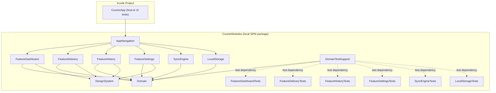
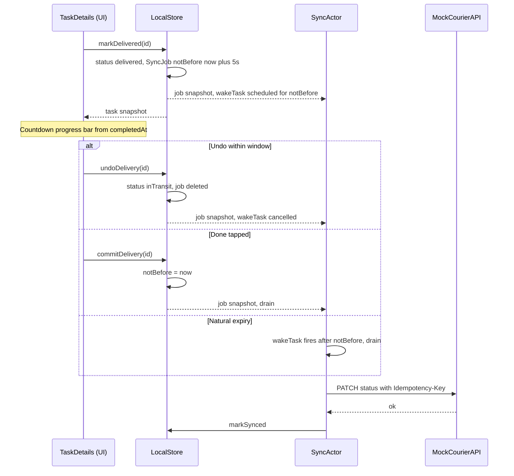

# CourierApp: Implementation Plan

Status: Phases 0 through 8 implemented, except for the manual E2E checklist from Phase 8. Quality gate (`make lint`, `make build`, `make test`) green on Xcode 26.6, iPhone 17 Pro, iOS 26.5. Unverified: UI visual polish, drag-and-drop smoothness, Xcode path on CI runner.

Environment: Xcode 26.6 (Swift 6.3.3), iPhone 17 Pro, iOS 26.5. Build commands executed with `DEVELOPER_DIR=/Applications/Xcode_26_6.app/Contents/Developer` because `xcode-select` had previously switched unexpectedly to 27.1.

## 1. Purpose and Scope

Architectural playground: offline-first, optimistic UI, outbox sync pattern, SPM micro-modules, Swift 6 strict concurrency. Functionality is intentionally scoped down to the minimum necessary to demonstrate these mechanisms. Visual styling is secondary.

## 2. Deviations from Handoff

Each deviation stems from a subsequent user decision, plan review, or technical constraints.

- **No `@Query` in views.** Feature modules consume `AsyncStream` exposed by repository protocols in `Domain` (Option A). Rationale: Feature modules do not have visibility into `@Model` types.
- **Undo is restricted to the `TaskDetails` screen**, not exposed in Dashboard rows. After tapping "Mark Delivered", the screen remains open and displays a countdown progress bar. The original handoff specified popping back to the Dashboard and showing a "Pending Delivery..." row. The Dashboard row concept has been removed.
- **One-time pull** (`GET /tasks` from local JSON) only for initial data seeding (empty database) and after a reset, complete with loading state and retry handling. **No pull-to-refresh.** The remote source is a static JSON file and merging is insert-only, meaning a refresh would behave identically to a reset (which already exists in Settings). The original handoff specified push-only synchronization.
- **No `deleted` status.** Data resets are hard deletions.
- **Additions:** `Other` exception reason (with a freeform text input), `shiftID` on tasks, a dedicated `Shift` entity, and `syncState` on tasks as a **computed property** during mapping (derived from the presence of a pending job in the outbox) rather than a persistent SwiftData column.
- **`scheduled` state in `Shift`** (prior to start). The user specification defined `active > finished`, but the shift card requires an initial state for shifts assigned by the server.
- **Job wake-up in `SyncActor`:** A single cancellable task scheduled for the earliest `notBefore` timestamp. This replaces sync timers in the UI (Undo window expiry, reorder debounce). The UI retains purely visual timers (progress bar, auto-pop). Additional drain trigger: foregrounding (`scenePhase == .active`). No background fetch.
- **Default isolation per module.** `MainActor` across the UI layer (`App`, `DesignSystem`, `Feature*`, `AppNavigation`). `nonisolated` in `Domain`, `LocalStorage`, and `SyncEngine`. Rationale: Defaulting to `MainActor` in data modules would tie domain models and `@Model` definitions to the main thread, invalidating the purpose of an isolated background writer actor.
- **`SyncEngine` does not depend on `LocalStorage`** in the production target. It depends exclusively on `Domain` (protocols). `LocalStorage` is only linked in the test target (for integration testing). This dependency edge can be restored if deemed necessary.
- **No `make format` Run Script phase in the build pipeline.** The original template included one, but build runs should never mutate source files (especially when compiling with warnings-as-errors and within package dependencies). `make format` remains an explicit command, while gates and CI rely strictly on `make lint`.

## 3. Default Decisions and Working Assumptions

All decisions are reversible and subject to review.

- Display name: `CourierApp`. Modifying this requires only updating `INFOPLIST_KEY_CFBundleDisplayName`.
- iPhone only, portrait orientation: `TARGETED_DEVICE_FAMILY = 1`.
- Localization: English as the only source language, but with complete localization infrastructure (String Catalog per module, semantic keys, no hardcoded UI literals).
- Dependency injection via initializers and closures. No DI containers or custom `@Environment` keys.
- Error retries occur exclusively on external triggers or process restarts. No automated backoff. Writing failure diagnostics (`attemptCount`, `lastFailure`) does not trigger another attempt. A single drain pass executes each eligible job at most once.
- Remote merges during pull are insert-only: unknown IDs are inserted, existing records are never overwritten. The mock server is stateless.
- Expiration of the Undo window: The job transitions to an eligible state on its own (via `SyncActor` wake-up), and the details view automatically pops. Tapping `Done` explicitly invokes `commitDelivery` (fast-forwarding `notBefore` to `now`). `onDisappear` (handling swipe back or tab switching) serves strictly as a safety fallback. `commitDelivery` is idempotent: it only acts on a `delivered` task within an active Undo window; in all other states, it is a safe no-op.
- Progress calculation on the shift card: `(delivered + exception) / total shift tasks`. Earnings: sum of `payout` for `delivered` tasks in the shift (excluding `exception`).
- `Shift`: `scheduled → active → finished`, where `finished` is a terminal state. "End Shift" is disabled while any task is `inTransit` (disabled button accompanied by inline explanation). Returning to the initial state is only possible via data reset in Settings. The shift entity is purely local and does not produce a `SyncJob`.
- Shift invariants are enforced by `LocalStore`, not the UI: `startDelivery`, `undoDelivery`, and `reorderQueue` require an active shift and a task belonging to that shift (`shiftNotActive`, `taskNotInActiveShift`). Consequently, completing a shift rejects Undo even if the time window has not elapsed. Transitions: `startShift` only from `scheduled`, `endShift` only from `active` (`invalidShiftTransition`).
- Permitted task transitions: `new → inTransit`, `inTransit → delivered | exception`, `delivered → inTransit` (strictly for Undo within the active window). All others are rejected (`invalidTransition`). Having multiple tasks concurrently `inTransit` is forbidden (`anotherTaskInTransit`).
- Exception reasons: Customer No-Show, Address Not Found, Package Damaged, Other (requires non-empty text).
- Server mock endpoints: `GET /tasks` (shift plus tasks), `PATCH /tasks/{id}/status`, `PATCH /route-optimization`. Random latency configured in Settings (default: 1 to 3 seconds). Simulated error modes: timeout, connection lost, 500, 503, 429.
- Queue reordering: Only one `SyncJob(.reorder)` is retained at any time. Any reorder operation replaces the existing job (new `id`, updated payload, `notBefore = now + 5 s`). Any mutation modifying the `new` queue composition (such as `startDelivery`) within the same transaction strips the task from the pending job's payload or deletes the job entirely if fewer than 2 tasks remain.
- `exception` bypasses the Undo window: `notBefore = now`.
- Delivery semantics: **At-least-once**. `SyncJob.id` serves as an idempotency key (forwarded via `Idempotency-Key` header). PATCH operations are absolute (target status, complete sequence order), meaning that resending the same job after a crash prior to local ACK is correct and safe behavior.
- SwiftData: Disk-backed, `VersionedSchema` v1 without migration plans. In-memory storage for unit tests and previews; temporary files for disk persistence tests.
- Logging: `os.Logger`, subsystem `com.kamilgomolka.CourierApp`, categories `storage`, `sync`, `network`, `navigation`. Log messages containing identifiers and statuses are marked with `privacy: .public`.
- History: Tasks with a pending status sync job display an additional `StatusBadge` labeled "Pending sync".
- Accessibility: Standard a11y omitted. Accessibility identifiers are exposed solely for UI automation.
- Commits: Generated only on request. A commit is proposed at the conclusion of each phase.

## 4. Architecture

### 4.1 Dependency Graph



`AppNavigation` (package module) serves as the Composition Root: It is the sole module with visibility into both `LocalStorage` and `SyncEngine`, injecting dependencies into features via initializers. The SwiftData container is instantiated in `AppNavigation` (`AppEnvironment.makeLive()`, initialized lazily in `.task` within `RootView`), while the host application target merely hosts `RootView`. `Feature*` modules depend solely on `Domain` and `DesignSystem`. `AppNavigation` also depends directly on `Domain` and `DesignSystem` (omitted from the diagram for clarity). `SyncEngineTests` links `LocalStorage` as an additional test dependency for integration tests. `DomainTestSupport` is a product used exclusively by test targets.

### 4.2 Directory Structure

```
demo-courier-v2/
├── CourierApp.xcodeproj
├── CourierApp.xctestplan                 # Host UI test plan
├── CourierApp/                           # Application host
│   ├── Source/Application/App.swift      # @main, embeds RootView from AppNavigation
│   └── SupportingFiles/                  # Info.plist, xcassets (AppIcon)
├── CourierAppUITests/                    # E2E UI tests (XCTest)
├── Config/                               # xcconfig files (strictness, platform)
├── CourierModules/                       # Unified local SPM package
│   ├── Package.swift                     # Target manifests & shared strictSettings
│   ├── Sources/
│   │   ├── Core/
│   │   │   ├── Domain/
│   │   │   ├── DomainTestSupport/        # Test doubles, fakes, fixtures (test-only)
│   │   │   ├── DesignSystem/
│   │   │   ├── LocalStorage/
│   │   │   └── SyncEngine/
│   │   ├── Features/
│   │   │   ├── FeatureDashboard/
│   │   │   ├── FeatureDelivery/
│   │   │   ├── FeatureHistory/
│   │   │   └── FeatureSettings/
│   │   └── App/
│   │       └── AppNavigation/
│   └── Tests/
│       ├── Core/
│       │   ├── DomainTests/
│       │   ├── DesignSystemTests/
│       │   ├── LocalStorageTests/
│       │   └── SyncEngineTests/
│       └── Features/
│           ├── FeatureDashboardTests/    # Swift Testing + DomainTestSupport
│           ├── FeatureDeliveryTests/
│           ├── FeatureHistoryTests/
│           └── FeatureSettingsTests/
└── Docs/implementationPlan.md
```

`Sources/<Layer>/<Module>/` (Layers: `Core`, `Features`, `App`; mapped via a path helper in `Package.swift` using `layer:`) alongside `Resources/` wherever needed. Package configuration: `swift-tools-version: 6.2`, `defaultLocalization: "en"`, `platforms: [.iOS(.v26)]`. The application host target links only the `AppNavigation` product.

Module names unchanged. Checked for conflicts against system modules: no collisions found. Internal rule: No type may share the same name as its parent module.

### 4.3 Strictness (Single Policy Across All Targets)

Host target (`xcconfig`, `Config/Project/ProjectBase.xcconfig`):

- `SWIFT_VERSION = 6.0`, `SWIFT_STRICT_CONCURRENCY = complete`
- `SWIFT_TREAT_WARNINGS_AS_ERRORS = YES`, `GCC_TREAT_WARNINGS_AS_ERRORS = YES` (Debug & Release)
- `SWIFT_STRICT_MEMORY_SAFETY = YES`
- Upcoming features: `ExistentialAny`, `InternalImportsByDefault`, `MemberImportVisibility`
- `SWIFT_APPROACHABLE_CONCURRENCY = YES` retained. Under Swift 6 mode, the only flags enabled by this setting are `NonisolatedNonsendingByDefault` and `InferIsolatedConformances`. Neither relaxes data-race safety. Package targets enable them explicitly.

Package manifest (`CourierModules/Package.swift`), shared `swiftSettings` configuration across all targets (source and test):

```swift
let strictSettings: [SwiftSetting] = [
    .strictMemorySafety(),
    .enableUpcomingFeature("ExistentialAny"),
    .enableUpcomingFeature("InternalImportsByDefault"),
    .enableUpcomingFeature("MemberImportVisibility"),
    .enableUpcomingFeature("NonisolatedNonsendingByDefault"),
    .enableUpcomingFeature("InferIsolatedConformances"),
]

.target(name: "Domain", swiftSettings: strictSettings)
.target(name: "FeatureDashboard", dependencies: ["Domain", "DesignSystem"], swiftSettings: strictSettings + [.defaultIsolation(MainActor.self)])
```

`.defaultIsolation(MainActor.self)` is applied strictly to UI modules. All settings are verified available in Xcode 26.6 (`PackageDescription.swiftinterface`). A single package manifest prevents configuration drift.

Warnings-as-errors for the package is omitted from `Package.swift`: `.treatAllWarnings(as: .error)` conflicts with `-suppress-warnings` when SPM targets are compiled as host dependencies (Spike 4). Instead, flags `SWIFT_SUPPRESS_WARNINGS=NO SWIFT_TREAT_WARNINGS_AS_ERRORS=YES` (`STRICT_WARNINGS` in `Makefile`) are supplied to every `xcodebuild` invocation.

`.swift-format`: `NeverForceUnwrap` and `NeverUseForceTry` are enabled (`true`). In test suites where unwrapping is required, `try #require` is used instead.

CI (`ci.yml`): `DEVELOPER_DIR` is pinned to Xcode 26.6 (matching runner image configuration), with a pre-flight step executing `xcodebuild -version` and `xcrun simctl list runtimes` to fail fast on mismatched toolchains. Uses `OS=latest` on CI runners, `OS=26.5` locally. The `lint` job shares this `DEVELOPER_DIR` and asserts that `swift-format` runs version 6.3.

### 4.4 Data Model (Domain, Pure `Sendable` Types)

- `DeliveryTask`: `id`, `recipientName`, `deliveryAddress`, `packageSummary`, `payout: Decimal` (GBP), `status`, `exceptionReason?`, `sortOrder`, `shiftID?`, `syncState` (**computed**), `assignedAt`, `completedAt?`.
- `TaskStatus`: `new`, `inTransit`, `delivered`, `exception`.
- `ExceptionReason`: `customerNoShow`, `addressNotFound`, `packageDamaged`, `other(details: String)`.
- `SyncState`: `pending`, `synced`. Derived when mapping a storage record to a domain snapshot: `pending` indicates the presence of an active `updateStatus` job for the task (a pending `reorder` job does not qualify). Because it is computed on the fly, state desynchronization with the outbox is structurally impossible.
- `Shift`: `id`, `status` (`scheduled`/`active`/`finished`), `startDate?`, `endDate?`.
- `ShiftSummary`: `status`, `earnings`, `completedCount`, `totalCount`, `hasTaskInTransit`. Calculated via a pure domain function.
- `SyncJob`: `id` (idempotency key), `kind`, `createdAt`, `notBefore`, `attemptCount`, `lastFailure?`.
- `SyncJobKind` (`Codable`): `updateStatus(taskID, TaskStatus, ExceptionReason?)`, `reorder(orderedTaskIDs)`.
- `NetworkConditions`: `isOffline`, `latencyRange`, `simulatedFailure`.
- `SyncPolicy`: `undoWindow = 5 s`, `reorderDebounce = 5 s`.
- `SyncTrigger`: `launch`, `foreground`, `screenAppeared`, `connectivityRestored`, `manual`. Internal triggers within `SyncActor`: `jobsChanged`, `wake`.
- Errors (typed throws): `RepositoryError` (`invalidTransition`, `anotherTaskInTransit`, `taskNotFound`, `undoWindowClosed`, `exceptionDetailsRequired`, `shiftHasTaskInTransit`, `shiftNotActive`, `taskNotInActiveShift`, `invalidShiftTransition`, `storageFailure`), `SyncError` (`offline`, `timedOut`, `connectionLost`, `server(status)`, `decodingFailed`, `cancelled`, `storageFailure(message)`).
- State Machine: Pure function `TaskStateMachine.apply(event, to: task)` operating on `TaskEvent`: `startDelivery`, `markDelivered(at)`, `undoDelivery`, `reportException(reason, at)`. Cross-entity invariants (single `inTransit` task, active shift verification, shift membership) are validated atomically by `LocalStore` inside the active transaction.

Protocols (all `Sendable`). Signatures are provisional until end-to-end integration across `LocalStorage`, `SyncEngine`, and features is complete (end of Phase 4b):

- `TaskRepository`: Streams `observeQueue()` (`inTransit` plus `new`, ordered), `observeTask(id)`, `observeCompleted()`. Mutations: `startDelivery`, `markDelivered`, `undoDelivery`, `commitDelivery` (idempotent), `reportException`, `reorderQueue`.
- `ShiftRepository`: `observeShiftSummary()`, `startShift()`, `endShift()`.
- `SyncJobRepository` (Outbox): `observeJobs()`, fetching eligible jobs, `markSynced`, `recordFailure`, `mergeRemoteSnapshot`.
- `SyncControlling`: `requestSync(trigger)`, `loadInitialData() async throws(SyncError)`, `resetLocalData() async`.
- `NetworkConditionsStore`: Reading and writing `NetworkConditions`.
- `LocalDataResetting`: Store-level `resetAllData()`. Called exclusively by `SyncActor` as part of `resetLocalData()`.

### 4.5 Storage and Observation: Single-Writer Actor

`LocalStorage` utilizes a single `@ModelActor` (`LocalStore`) acting as the sole reader and writer for SwiftData. `@Model` classes (`DeliveryTaskRecord`, `ShiftRecord`, `SyncJobRecord`) are strictly `internal` and never escape the module boundary. External consumers receive only immutable domain structs.

- **Serialized blocking writes:** Actor isolation guarantees that transactions execute strictly one after another.
- **Atomic state mutation and outbox enqueueing** (single `save()`): Task status updates, job creation, and pending `reorder` adjustments commit together.
- **Observation without `@Query`:** Following every successful `save()`, `LocalStore` recalculates active streams and yields snapshots to `AsyncStream` (`bufferingNewest(1)`) only when changed (`Equatable`).
- **Stream lifecycle:** Stream termination handlers (`onTermination`) unregister continuations from the actor's registry. UI models cancel their consuming task on view dismissal (`.task` or explicit `stop()`). Verified via test: terminating consumers reduces active observer counts back to zero (checked via internal diagnostic hook).
- **Single-context consistency:** Avoids cross-context merge conflicts by processing all data operations within one `ModelContext`.
- Factory methods `CourierStorage.makeContainer(isStoredInMemoryOnly:)` and its file URL equivalent (used for disk persistence tests) are `public`. The production container is initialized by `AppEnvironment` inside `AppNavigation`.
- `UserDefaultsNetworkConditionsStore` accepts a `UserDefaults` suite and key prefix. Test suites isolate their execution using dedicated ephemeral suites cleared in teardown.

### 4.6 Synchronization (SyncEngine)

`SyncActor` serves as the sole consumer of the outbox by subscribing to `observeJobs()`.

- **Job eligibility** is governed by wall-clock time: `job.notBefore <= now`.
- **Wake-up scheduling:** `SyncActor` maintains a single cancellable `wakeTask` sleeping until the earliest `notBefore` timestamp across pending jobs. Any modification to the queue cancels the current task and recalculates the deadline; a generation counter (`wakeGeneration`) ensures stale wake-up callbacks are discarded. Once the deadline passes, a drain pass runs automatically. Thus, enqueuing a job with a 5-second window guarantees eventual execution without UI intervention.
- **Scheduler fingerprinting:** Queue updates trigger rescheduling and queue drains only when the fingerprint set of tuples `(id, kind, notBefore)` mutates. `attemptCount` and `lastFailure` are intentionally excluded from the fingerprint, preventing error diagnostic updates from causing retry loops. Full snapshots containing attempts and diagnostics are piped independently to the Settings debugger.
- **External triggers** (each initiating a single drain): `launch`, `foreground`, `screenAppeared`, `connectivityRestored`, `manual` ("Sync now"). Background fetch is excluded.
- **Queue drain logic:** Fetch eligible jobs (FIFO ordered by `createdAt`), dispatch each job at most once per pass. On success: Transaction removes the job from the outbox. On failure: Increment `attemptCount` and record `lastFailure`. A failed job blocks subsequent jobs targeting the same `taskID` for the duration of the cycle to preserve ordering, while allowing jobs for other tasks to proceed. Connectivity failures (`offline`) and task cancellations abort the active drain run. Overlapping drain requests coalesce via a "rerun needed" flag.
- **Recoverable failures:** HTTP 401 triggers `SessionRefreshing.refresh()` and one immediate retry for snapshot and outbox requests; `attemptCount` is untouched unless a job retry fails. HTTP 409 carries `serverUpdatedAt`; Last Write Wins compares it with the job's `createdAt`: a newer local write is resent once, while a newer server version is fetched and atomically reconciled with the outbox. Both are simulated via `SimulatedFailure.unauthorized` / `.conflict`.
- **Background grace:** On `scenePhase == .background` the app holds a `beginBackgroundTask` assertion until no job with `attemptCount == 0` remains (or the system expires it), letting the `notBefore` wake timer flush the Undo-held job.
- **Retrying failed jobs** (`attemptCount > 0`) is gated strictly on external triggers (`requestSync`). Automated drains triggered by queue updates or wake timers bypass failed jobs and continue blocking subsequent changes for affected `taskIDs`.
- **Corrupt outbox records** (failed deserialization of `SyncJobKind`) are skipped and logged. They do not block queries or the drain.
- **At-least-once delivery:** If the process terminates after a successful remote request but before the local job deletion commits, the job will be replayed upon restart. This is handled gracefully: `SyncJob.id` acts as the `Idempotency-Key` and status PATCH endpoints are idempotent. When a `reorder` job is updated, a fresh `id` is generated.
- **Cancellation support:** `MockCourierAPI`, sleep timers, and the queue drain loop fully support Swift Concurrency cancellation. An interrupted cycle avoids logging errors. Calling `markSynced` on an already-deleted job is a safe no-op.
- **Composite data reset:** Calling `SyncControlling.resetLocalData()` cancels and awaits `wakeTask`, any active queue drain, and initial seeding operations; then invokes `LocalDataResetting.resetAllData()`; and finally restarts the subscription before running `loadInitialData()`. This guarantees that in-flight requests cannot commit stale data to a wiped database.
- `MockCourierAPI` reads bundled JSON fixtures, honors `NetworkConditions`, tracks seen `Idempotency-Key` values for verification, and idempotently accepts replays. Time calculations use an injected `Clock`, and latency is driven by an injected delay provider (configured deterministically in tests).
- Window holds:
  - `delivered`: `notBefore = completedAt + 5 s`.
  - `reorder`: `notBefore = lastMoveTimestamp + 5 s`.
  - `exception`, `inTransit`: `notBefore = now`.

### 4.7 Delivered, Undo, and Commit Flow



`undoDelivery` is permitted exclusively while the job exists in the outbox and `notBefore > now`. Calling `commitDelivery` or allowing the window to expire leads to rejection with `undoWindowClosed`. This prevents race conditions with `SyncActor` without needing an explicit `inFlight` flag.

The progress bar is powered by `ProgressView(timerInterval:countsDown:)` bound to `completedAt ... completedAt + undoWindow`. The countdown base is persisted locally in `completedAt`. The UI countdown timer is purely cosmetic: reaching completion simply dismisses the view.

### 4.8 Navigation and UI

- A root `TabView` manages three tabs, each wrapping an independent `NavigationStack(path:)`. A single `@Observable` router inside `AppNavigation` retains path state.
- Feature modules remain decoupled from one another. The Dashboard module emits `onSelectTask(id)`, the navigation router pushes `DashboardRoute.taskDetails(id)`, and a `navigationDestination` resolves the view from `FeatureDelivery`. `TaskDetails` requests dismissal through an `onFinish` closure.
- Tapping `Done` explicitly triggers `commitDelivery`. `onDisappear` acts as a fallback handler (idempotent no-op if Undo, auto-pop, or commit has already executed).
- **Dashboard:** Uses a decoupled `ShiftCardView` (backed by its own `@Observable ShiftCardModel` and stream) alongside the task list (`TaskQueueModel`). UI models only assign new values when snapshots differ (`@Observable` does not perform automatic equality diffing). Shift metric updates do not cause task list row invalidations.
- Inactive shifts (`scheduled` or `finished`): Rows are marked `.disabled` with reduced `opacity`, allowing list scrolling while hiding the `EditButton`. This is purely presentation-layer enforcement, as business rules are guaranteed by `LocalStore`.
- Queue reordering: Utilizes `List` with `.onMove` constrained to the `new` section, toggled via `EditButton` in the navigation toolbar. Does not display blocking loading spinners during drag-and-drop or sync events. Debouncing is handled via job `notBefore` holds and `SyncActor` wake-up scheduling. UI models do not manage sync timers.
- Initial loading states: A spinner appears only when launching with an empty database (initial cold start or following a reset). Initialization failures present an `EmptyStateView` with retry support. No pull-to-refresh.
- `TaskDetails`: A task in `new` presents a "Start Delivery" button, transitioning in place to `inTransit` controls once tapped. In `inTransit`, the view provides "Mark Delivered" (accented green) and "Report Exception" (accented red, opening a bottom sheet with radio choices and freeform text input for `Other`). Following `delivered`, the view transitions to the Undo progress bar alongside a `Done` button.
- History: Groups completed tasks into daily sections sorted descending by `completedAt`. Tasks marked as `exception` show a warning indicator and display the failure reason as a subtitle (including custom input for `Other`). Navigation to task details is omitted.
- Settings: Simulate Offline, latency range (from, to), simulated error picker, Reset local data, a list of queued outbox jobs (kind, retry counts, `notBefore`, last recorded error), and a "Sync now" button.

### 4.9 DesignSystem (Incremental, Built Alongside First UI)

`DesignSystem` is introduced during Phase 4a and expands alongside feature development. It is untouched during Phase 1.

- `Colors.xcassets` (starting Phase 4a): Semantic tokens (`BackgroundPrimary`, `SurfaceCard`, `TextPrimary`, `TextSecondary`, `Accent`, `Success`, `Danger`, `Warning`) with Any and Dark appearances. Tokens are added strictly as needed.
- `Images.xcassets`: Created only once the first image appears (icons come from SF Symbols, so none for now).
- Typography: Semantic roles mapped directly to system styles (`.title`, `.headline`, `.body`, `.caption`), with full Dynamic Type support.
- Component library added on demand: `PrimaryButton` and `EmptyStateView` (Phase 4a), `success` and `destructive` button variants (Phase 4b), `StatusBadge` (Phase 6). Components accept `LocalizedStringResource` and contain zero business logic. All public APIs include DocC (`///`) documentation.

### 4.10 Localization

- Dedicated `Localizable.xcstrings` per UI module, placed in `Sources/<Layer>/<Module>/Resources/` alongside view implementations. Verified via build spike in Phase 0.
- Semantic key hierarchy: `<screen>.<element>.<role>` using camelCase segments (e.g., `dashboard.shiftCard.startButton`).
- Access via generated symbols (as in the template: `String(localized: .key)`). Zero raw string literals in UI code.
- Shared phrases repeated across multiple features (e.g., exception reason labels displayed in both `FeatureDelivery` and `FeatureHistory`) are duplicated locally within each module catalog to preserve module independence.
- Regional context: Tailored to the United Kingdom (`en-GB`). Mock data (`courier-snapshot.json`) features British names, addresses located in London (with standard UK postcodes), and payouts denominated in GBP (`.currency(code: "GBP")`). Simulated courier coordinate origins are located in Central London (Marylebone/Fitzrovia), without using the device's real location. Dates and numbers are formatted with `Locale(identifier: "en_GB")`.

### 4.11 Testing Strategy

- **Package unit tests:** Written strictly using Swift Testing (`@Test`, `#expect`, `try #require`). Mock implementations (`DomainMocks` from `DomainTestSupport`) are injected into view models via initializers. UI test targets never import `LocalStorage`.
- **Host UI tests:** Driven by XCTest, treating the built binary as a black box and validating end-to-end user flows using accessibility identifiers exposed by UI modules.
- `DomainTestSupport` is linked solely by test targets.

## 5. Phases

Every phase must pass the quality gate: `make lint && make build && make test` (with warnings treated as errors) on Xcode 26.6, iPhone 17 Pro, iOS 26.5. A review follows each phase, with commits created only upon confirmation. `make format` is run manually before executing the gate.

Development approach: **Hybrid.** Phases 1 through 3 are horizontal slices (shared core contracts and data pipelines carry the highest architectural risk and are fully verifiable without UI). Phases 4 through 7 are implemented as vertical slices delivering working features directly on the simulator. The horizontal phases keep architectural diffs focused and reviewable, while vertical phases catch integration issues early. Domain contracts defined in Phase 1 remain provisional until Phase 4b completes.

### Phase 0: Template Migration & SPM Skeleton (Structure, Compilation, Strictness)

Migrate the project from the monolithic single-target template to the modular architecture outlined in 4.1 through 4.3.

- [x] `Config/`: Apply strictness settings from 4.3, set `TARGETED_DEVICE_FAMILY = 1`, restrict to portrait orientation, correct inaccurate warnings-as-errors descriptions and Run Script references in the README.
- [x] `pbxproj`: Remove the automated `make format` Run Script build phase.
- [x] `.swift-format`: Enable `NeverForceUnwrap` and `NeverUseForceTry`.
- [x] `Makefile`: Set `OS ?= 26.5`, extend `SWIFT_SOURCES` to index `CourierModules`.
- [x] `ci.yml`: Configure `DEVELOPER_DIR`, log Xcode and runtime diagnostics, set `OS=latest`.
- [x] **Monolith teardown:** Remove obsolete boilerplate files (`MainView.swift`, `SampleFeatureView.swift`, unused directories under `CourierApp/Source/`, host-level `Localizable.xcstrings`, and `MainViewTests.swift`). Delete the `CourierAppTests` target in favor of package-level tests.
- [x] **SPM package setup:** Create `CourierModules/Package.swift` declaring 10 source targets (under `Sources/`, including `DomainTestSupport`) and corresponding test targets (`Tests/`). Apply `strictSettings` across all targets, adding `defaultIsolation(MainActor)` for UI modules. Stub each target with an initial source file.
- [x] **Xcode integration:** Link `CourierModules` as a local package dependency (`XCLocalSwiftPackageReference`) in `CourierApp.xcodeproj`. Under *Frameworks, Libraries, and Embedded Content*, link only the `AppNavigation` library product.
- [x] **AppNavigation placeholder:** Implement a stub `RootView.swift` importing all `Feature*` targets to validate graph resolution. Update `App.swift` to mount `RootView`.
- [x] **Test execution:** Configure `CourierAppUITests` in `CourierApp.xctestplan`. Package unit tests run via `make test-package` (Spike 4).
- [x] **Feasibility spikes (temporary implementations removed before phase completion), logged in Section 7:**
  1. `@Model` and `@ModelActor` compilation in `LocalStorage` under strict memory safety and warnings-as-errors.
  2. Compile-time symbol generation for String Catalogs in `FeatureDashboard` (`String(localized: .key)`).
  3. Compile-time color symbol generation from `Colors.xcassets` in `DesignSystem`, including Dark Mode variants.
  4. SPM target test execution using `import Testing` triggered via `make test`.
- Exit criteria: `make build`, `make lint`, and `make test` pass cleanly; the host links solely against `AppNavigation`; all spikes resolve positively; and the workspace is ready for domain implementation.

### Phase 1: Domain (Horizontal Slice)

- [x] `Domain`: Define entities, enumerations, error types, `SyncPolicy`, `TaskStateMachine`, `ShiftSummary`, and draft protocol contracts from 4.4. Populate `DomainTestSupport` with domain mocks, fakes, and test fixtures.
- [x] Unit tests: State machine transition table (all states across all events), `ShiftSummary` calculations (earnings, progress, zero-task edge cases), and `SyncJobKind` serialization round-trips.
- Exit criteria: Core domain contracts complete and verified as working drafts.

### Phase 2: LocalStorage (Horizontal Slice)

- [x] Implement `VersionedSchema` v1, `@Model` records, and record-to-domain mapping logic (including dynamic derivation of `syncState`).
- [x] `LocalStore`: Implement mutations along with domain invariants (including shift status and task shift affiliation checks), single-transaction outbox enqueueing, automatic payload adjustment for pending `reorder` jobs upon queue modifications, idempotent `commitDelivery`, deduplicated observation streams with teardown handling, insert-only `mergeRemoteSnapshot`, and `resetAllData`.
- [x] Expose `LocalStorage.makeContainer` (in-memory and disk URL variants) and implement `UserDefaultsNetworkConditionsStore`.
- [x] Configure the `storage` subsystem logger.
- [x] In-memory unit tests: State transitions with atomic outbox job persistence, rejection of duplicate `inTransit` tasks, validation preventing `startDelivery` and `reorderQueue` without an active shift or on unassigned tasks, `invalidShiftTransition` assertions, Undo behavior within the active window vs. post-commit, verification of `commitDelivery` as a no-op across non-delivered states, reorder job coalescing, dynamic `syncState` calculation, stream lifecycle tests (initial emission, deduplication, observer termination), shift metric correctness, and isolated `UserDefaultsNetworkConditionsStore` tests.
- [x] **Disk persistence tests** (using sandboxed ephemeral store files cleaned up on teardown): Job persistence across `LocalStore` re-initialization, process restarts mid-way through an active Undo window (asserting hold retention and functional Undo), and restarts past window expiry (asserting immediate job eligibility).

### Phase 3: SyncEngine (Horizontal Slice, Headless)

- [x] Implement `MockCourierAPI` reading bundled `Resources/MockData/courier-snapshot.json` (1 `scheduled` shift, 12 tasks with matching `shiftID`), supporting `Idempotency-Key` validation, request cancellation, injected `Clock`, and deterministic latency providers.
- [x] `SyncActor`: Outbox subscription using `observeJobs()` paired with scheduler fingerprinting, `wakeTask` management, external trigger handling, `loadInitialData`, `resetLocalData`, and drain run coalescing.
- [x] Configure `sync` and `network` subsystem loggers.
- [x] Unit tests with injected `Clock`, fixed reference time, and controlled latency:
  - Jobs remain un-dispatched prior to `notBefore`, dispatching exactly once upon reaching eligibility.
  - Queue mutations (Undo invocations, reorder replacements) reschedule or cancel the active `wakeTask`.
  - Drain runs process jobs FIFO and dispatch each job at most once per pass.
  - **A single external sync trigger results in at most one retry per failed job** (avoiding retry loops when encountering persistent 500 errors).
  - Offline state halts queue processing and preserves queued jobs; errors increment `attemptCount` without re-triggering immediate drains.
  - Error simulation mappings match expected `SyncError` values.
  - Successful requests remove completed jobs from the outbox.
  - `loadInitialData` successfully populates an empty database and operates idempotently.
  - Full integration tests verifying interaction with a real `LocalStore`.
- [x] **Disk persistence and resiliency tests (disk-backed store):**
  - Processing overdue jobs immediately after recreating `LocalStore` and `SyncActor`.
  - Crash recovery simulation: Replaying the same `SyncJob.id` after a simulated crash prior to local ACK, asserting that the server accepts the duplicate idempotently.
  - Data reset during an in-flight request: The pending request is discarded without writing stale records to the refreshed database, and the background worker resumes cleanly.
- Exit criteria: Entire offline-first synchronization pipeline operational and validated without UI dependencies.

### Phase 4a: Dashboard & Navigation Skeleton (Vertical Slice)

- [x] `DesignSystem`: Initialize `Colors.xcassets` with required tokens, typography styles, `PrimaryButton`, `EmptyStateView`, and light/dark appearance resolution unit tests.
- [x] `AppNavigation`: `AppEnvironment` wiring (coordinating the SwiftData container, `LocalStore`, `SyncActor`, `MockCourierAPI`, and settings store), `RootView` shell, three navigation stacks, central router, placeholder views for History and Settings, and lifecycle triggers for `launch` and `foreground` (`scenePhase`).
- [x] Configure `App.swift` to mount `RootView`. `RootView` lazily spins up `AppEnvironment` inside `.task`, presenting an `EmptyStateView` upon failure (no `try!`).
- [x] `FeatureDashboard` (including `Localizable.xcstrings`): `ShiftCardModel` and view, `TaskQueueModel` and list view, loading/error (retry)/empty states, row `.disabled` state enforcement during inactive shifts, and shift start/finish actions with `inTransit` guards.
- [x] View model unit tests backed by `DomainTestSupport` fakes (including stream cancellation validation).
- Functional verification: App launches, seeds data from the mock fixture (with loading indicator), and renders the shift card alongside the task list.

### Phase 4b: Delivery (Vertical Slice)

- [x] `FeatureDelivery` (including string catalog): `TaskDetailsModel`, view implementation (handling `new`, `inTransit`, and `delivered` with the Undo progress bar and `Done` action), and `ExceptionReportSheet` (four radio selections with mandatory input validation when `Other` is selected).
- [x] `DesignSystem`: Add `success` and `destructive` style variants to `PrimaryButton`.
- [x] `AppNavigation`: Configure `navigationDestination` mapping, auto-dismissal on countdown expiry, explicit `commitDelivery` on `Done`, and fallback execution in `onDisappear`.
- [x] Unit tests: In-place state transitions without popping the view, Undo execution inside the active window, `Done` committing delivery, fallback verification (asserting no-op if Undo or commit already ran), and validation rules for `Other`.
- [x] Review integration points and freeze `Domain` protocols.
- Functional verification: Full task progression (`new → inTransit → delivered/exception`) with outbox activity visible in system logs.

### Phase 5: Reorder (Vertical Slice)

- [x] `FeatureDashboard`: Enable `.onMove` reordering paired with toolbar `EditButton` (hidden when shift is inactive), scoped exclusively to the `new` section.
- [x] UI model contains no sync timers: Job debounce is delegated to `notBefore` holds and `SyncActor` wake-up scheduling.
- [x] Unit tests: Queue ordering following moves, job coalescing, non-blocking UI behavior while offline, deadline extension on successive moves, and rejection of reordering attempts when the shift is inactive.

### Phase 6: History (Vertical Slice)

- [x] `FeatureHistory` (including string catalog): `HistoryModel`, daily date grouping, `StatusBadge` integration in `DesignSystem` (displaying "Pending sync"), and subtitle presentation of exception reasons.
- [x] Unit tests verifying section grouping, reverse-chronological sorting, and proper formatting for `Other` exception details.

### Phase 7: Settings (Vertical Slice)

- [x] `FeatureSettings` (including string catalog): View model, network simulation controls, destructive local data reset trigger (delegating to `SyncControlling.resetLocalData()`), and outbox inspection view with "Sync now" action.
- [x] Toggling from offline to online triggers `requestSync(.connectivityRestored)`.
- [x] Unit tests covering settings view model state and configuration persistence via protocol.

### Phase 8: Hardening

- [x] Documentation: Comprehensive README covering architecture, module dependency graph, key engineering trade-offs, setup guide, and active CLI commands.
- [x] UI smoke tests: App launch, tab navigation, and full execution of the `Start Delivery → Mark Delivered → Undo` flow.
- [x] Static analysis audit: Zero warnings, zero forced unwraps/casts (`!`, `try!`, `as!`), no narrative comments, removal of unused imports/symbols, and zero raw string literals in UI code.
- [ ] Manual E2E test verification checklist (offline mode transitions, network error handling, process termination during active Undo window, queue reordering while offline, and database reset during in-flight network calls).

## 6. Verification

- Run `make format` (explicitly), followed by `make lint`, `make build`, and `make test` at the end of each phase.
- Simulator-dependent commands (`xcodebuild test`, `simctl`) require access outside the sandbox environment. Permission will be requested prior to initial invocation.
- Real-time logging verification: `xcrun simctl spawn booted log stream --predicate 'subsystem == "com.kamilgomolka.CourierApp"'`.
- Items requiring manual review: Visual UI polish and drag-and-drop animation fluidity cannot be validated programmatically and will be flagged for review upon completion of Phases 4 through 7. Verification of the `DEVELOPER_DIR` path for Xcode 26.6 on the CI runner will be confirmed upon initial CI run.

## 7. Risks and Spike Findings

- **SwiftData under strict memory safety and warnings-as-errors:** `@Model` and `@ModelActor` macros can trigger internal compiler diagnostics. Fallback plan: Disable `strictMemorySafety` specifically for `LocalStorage` (documented as an approved exception).
- **Asset and String Catalog symbol access across SPM targets:** Fallback plan for strings: Introduce an internal typed enumeration within each module wrapping `LocalizedStringResource(…, bundle: .atURL(Bundle.module.bundleURL))`. Fallback plan for colors: Centralize `Color("Name", bundle: .module)` calls behind unit tests validating asset resolution.
- **`@ModelActor` integration under Swift 6:** Should the macro run into isolation diagnostics, fall back to a manual actor wrapping an isolated `ModelContext`.
- **Package test execution via `xctestplan`:** The test plan container identifier (`container:CourierModules`) may fail to resolve package targets. Fallback plan: Run package schemes explicitly via `xcodebuild test` in the `Makefile`.
- **Timer wake-up after `notBefore` during background suspension:** When the app is suspended in the background, `wakeTask` execution pauses. This is mitigated by triggering a queue drain upon returning to the foreground (`foreground`). The lack of guaranteed background delivery is an acknowledged design trade-off (no background fetch).

Spike Findings (Phase 0):

1. `@Model` and `@ModelActor` under full strictness (strict memory safety, warnings-as-errors): Compiles and runs cleanly. `LocalStore` is implemented as an `actor` conforming to `ModelActor` (using a manual `DefaultSerialModelExecutor`).
2. Package String Catalog compile-time symbols (`Text(.dashboardShiftCardStartButton)`, `String(localized: .key)`): Fully functional; fallback plan unnecessary.
3. Package color symbols from `Colors.xcassets` (`Color(.accent)`), including Dark Mode: Fully functional; validated via `PaletteTests` asserting token resolution across both appearances.
4. Swift Testing targets within SPM: Resolved via Fallback Plan B. Package test suites are not exposed inside `CourierApp.xctestplan`. Therefore, `make test` splits into `test-package` (`xcodebuild test -scheme CourierModules` targeting `CourierModules/`) and `test-app` (host UI test target). Warnings-as-errors is enforced using `SWIFT_SUPPRESS_WARNINGS=NO SWIFT_TREAT_WARNINGS_AS_ERRORS=YES` in the `Makefile`, as `.treatAllWarnings` in `Package.swift` conflicts with `-suppress-warnings` during host build resolution.

Implementation-Level Deviations:

- `TimeSource.sleep(until:)` replaces an injected `Clock`: Prevents race conditions between computing relative sleep durations and clock advances during test runs.
- The SwiftData store file is explicitly named `CourierStore` to avoid conflicts with `default.store` created by other prototypes sharing the same bundle identifier.
- Invoking `reportException` dismisses the task details view immediately (exceptions do not offer an Undo window).
- `Done`, Undo window expiration, and `onDisappear` all route through the same idempotent `commitDelivery` call; `onFinish` is invoked at most once.
- The UI smoke test suite (Phase 8) covers: Three-tab navigation, `Start Delivery → Mark Delivered → Undo`, `Done` flow, history display, `Other` exception validation, and the Settings screen.
