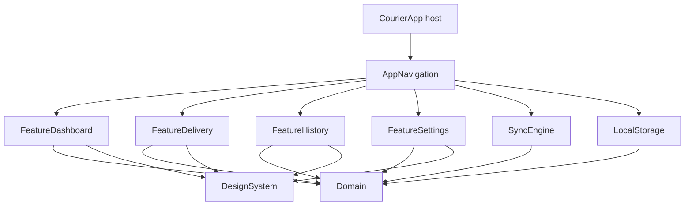
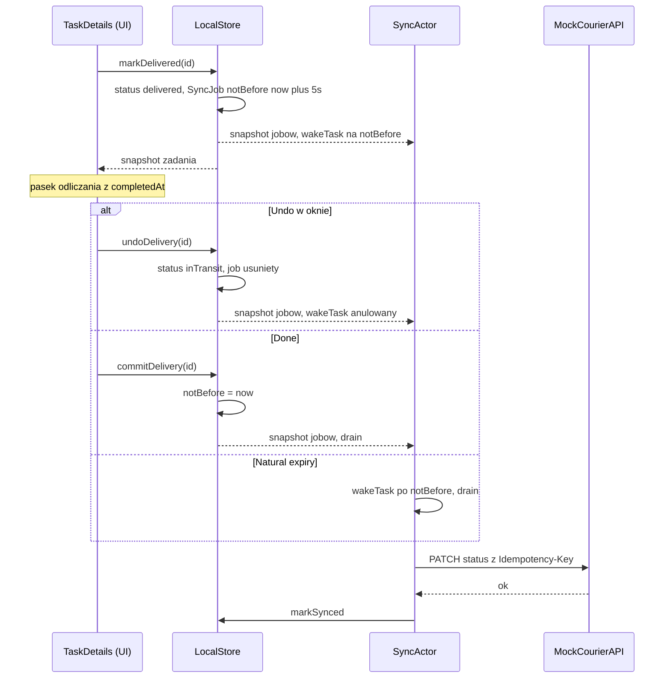

# CourierApp: plan implementacji

Status: Plan gotowy, impelmentacja nie zaczęta.

Środowisko: Xcode 26.6 (Swift 6.3.3), iPhone 17 Pro, iOS 26.5. Komendy buildowe uruchamiane z `DEVELOPER_DIR=/Applications/Xcode_26_6.app/Contents/Developer`, bo `xcode-select` już raz przeskoczył na 27.1.

## 1. Cel i zakres

Architektoniczny playground: offline-first, optimistic UI, outbox sync, mikro-moduły SPM, Swift 6 strict concurrency. Funkcjonalność ograniczona do minimum potrzebnego do pokazania tych mechanizmów. Wygląd UI jest drugorzędny.

## 2. Odstępstwa od handoffu

Każde z nich wynika z późniejszej decyzji użytkownika, review planu albo z ograniczeń technicznych.

- **Brak `@Query` w widokach.** Feature'y konsumują `AsyncStream` z protokołów repozytoriów w `Domain` (opcja A). Powód: feature'y nie widzą `@Model`.
- **Undo tylko na ekranie `TaskDetails`**, nie w wierszu Dashboardu. Po "Mark Delivered" ekran zostaje otwarty i pokazuje pasek odliczania. Handoff mówił o pop do Dashboardu i wierszu "Pending Delivery...". Wiersz na Dashboardzie wypada.
- **Jednorazowy pull** (`GET /tasks` z lokalnego JSON) tylko do początkowego załadowania danych (pusta baza) i po resecie, z loading state i retry. **Bez pull-to-refresh.** Źródłem jest statyczny JSON, a merge jest insert-only, więc odświeżanie działałoby jak reset, który jest w Settings. Handoff opisywał wyłącznie push.
- **Brak statusu `deleted`.** Reset danych to twarde usunięcie.
- **Dodane:** powód wyjątku `Other` (z polem tekstowym), `shiftID` na zadaniu, encja `Shift`, `syncState` na zadaniu jako **pole wyliczane** przy mapowaniu (obecność jobu w outboxie), a nie kolumna w SwiftData.
- **Stan `scheduled` w `Shift`** (przed startem). Spec użytkownika mówił `active > finished`, ale karta zmiany potrzebuje stanu początkowego dla zmiany przypisanej przez serwer.
- **Wybudzanie jobów w `SyncActor`:** jedno anulowalne zadanie dla najwcześniejszego `notBefore`. Zastępuje timery sync w UI (wygaśnięcie Undo, debounce reorderu). UI zachowuje wyłącznie timer wizualny (pasek, auto-pop). Dodatkowy trigger drain: foreground (`scenePhase == .active`). Bez background fetch.
- **Domyślna izolacja per moduł.** `MainActor` w warstwie UI (aplikacja, `DesignSystem`, `Feature*`, `AppNavigation`). `nonisolated` w `Domain`, `LocalStorage`, `SyncEngine`. Powód: `MainActor` jako domyślna izolacja w modułach danych zrobiłby z modeli domenowych i `@Model` typy związane z głównym wątkiem, co niszczy sens osobnego aktora zapisu.
- **`SyncEngine` nie zależy od `LocalStorage`** w targecie produkcyjnym. Zależy tylko od `Domain` (protokoły). `LocalStorage` jest zależnością targetu testowego (testy integracyjne). Krawędź wraca, jeśli okaże się potrzebna.
- **Brak Run Script `make format` w buildzie.** Szablon go miał, ale build nie powinien modyfikować źródeł (zwłaszcza przy warnings-as-errors i źródłach pakietów). `make format` zostaje jawnym poleceniem, a gate i CI opierają się na `make lint`.

## 3. Decyzje przyjęte domyślnie

Wszystkie odwracalne. Do korekty na review.

- Nazwa wyświetlana aplikacji: `CourierApp`. Zmiana to jedna linia `INFOPLIST_KEY_CFBundleDisplayName`.
- Tylko iPhone, portret. `TARGETED_DEVICE_FAMILY = 1`.
- Lokalizacja: tylko angielski jako język źródłowy, ale pełna infrastruktura (String Catalog per moduł, klucze semantyczne, brak literałów w kodzie).
- DI przez inicjalizatory i closure'y. Bez kontenera DI i bez własnych kluczy `@Environment`.
- Retry po błędzie wyłącznie od zewnętrznego triggera lub restartu procesu. Bez backoffu. Zapis diagnostyki błędu (`attemptCount`, `lastFailure`) nie wyzwala kolejnej próby. Jeden drain próbuje każdy kwalifikujący się job co najwyżej raz.
- Merge przy pulu jest insert-only: nieznane `id` wstawiamy, istniejących wierszy nie nadpisujemy. Mock serwera jest bezstanowy.
- Wygaśnięcie okna Undo: job staje się kwalifikowalny sam (wybudzenie w `SyncActor`), ekran szczegółów zamyka się automatycznie (pop). `Done` jawnie wywołuje `commitDelivery` (przyspiesza `notBefore` do `now`). `onDisappear` (swipe back, zmiana taba) to wyłącznie fallback. `commitDelivery` jest idempotentny: działa tylko dla zadania `delivered` z aktywnym oknem, w pozostałych stanach to bezpieczny no-op.
- Progress na karcie zmiany: `(delivered + exception) / wszystkie zadania zmiany`. Earnings: suma `payout` zadań `delivered` w zmianie (bez `exception`).
- `Shift`: `scheduled → active → finished`, `finished` jest stanem końcowym. "End Shift" zablokowany, gdy istnieje zadanie `inTransit` (przycisk disabled plus komunikat przy przycisku). Powrót do stanu początkowego tylko przez reset danych w Settings. Zmiana jest lokalna i nie generuje `SyncJob`.
- Inwarianty zmiany egzekwuje `LocalStore`, nie UI: `startDelivery` i `reorderQueue` wymagają aktywnej zmiany i zadania należącego do niej (`shiftNotActive`, `taskNotInActiveShift`). `startShift` tylko ze `scheduled`, `endShift` tylko z `active` (`invalidShiftTransition`).
- Dozwolone przejścia zadania: `new → inTransit`, `inTransit → delivered | exception`, `delivered → inTransit` (wyłącznie Undo w oknie). Reszta zabroniona (`invalidTransition`). Drugi `inTransit` zabroniony (`anotherTaskInTransit`).
- Powody wyjątku: Customer No-Show, Address Not Found, Package Damaged, Other (wymaga niepustego tekstu).
- Mock serwera: `GET /tasks` (zmiana plus zadania), `PATCH /tasks/{id}/status`, `PATCH /route-optimization`. Opóźnienie losowe z zakresu ustawianego w Settings (domyślnie 1 do 3 s). Błędy symulowane: timeout, utrata połączenia, 500, 503, 429.
- Reorder: jeden `SyncJob(.reorder)` naraz. Zmiana kolejności podmienia job (nowe `id`, nowy payload, `notBefore = now + 5 s`). Mutacje zmieniające skład kolejki `new` (np. `startDelivery`) w tej samej transakcji usuwają zadanie z payloadu oczekującego jobu albo usuwają job, gdy zostaje mniej niż 2 elementy.
- `exception` omija okno Undo: `notBefore = now`.
- Semantyka dostarczania: **at-least-once**. `SyncJob.id` jest kluczem idempotencji (nagłówek `Idempotency-Key` w mocku). Operacje PATCH są absolutne (docelowy status, pełna kolejność), więc ponowne wysłanie tego samego jobu po crashu przed lokalnym ACK jest poprawnym zachowaniem.
- SwiftData: dysk, `VersionedSchema` v1 bez planu migracji. In-memory w testach jednostkowych i previews, plik tymczasowy w testach trwałości.
- Logowanie: `os.Logger`, subsystem `com.kamilgomolka.CourierApp`, kategorie `storage`, `sync`, `network`, `navigation`. Wiadomości z identyfikatorami i statusami oznaczone `privacy: .public`.
- Historia: wiersze z oczekującym jobem statusu mają dodatkowy `StatusBadge` "Pending sync".
- Brak `a11y`. Accessibility identifiers tylko dla UI testów.
- Commity: tylko na prośbę. Po każdej fazie proponuję commit.

## 4. Architektura

### 4.1 Graf zależności



`AppNavigation` zależy też bezpośrednio od `Domain` i `DesignSystem`. Dla czytelności pominięte na diagramie.

### 4.2 Struktura katalogów

```
demo-courier/
├── CourierApp.xcodeproj
├── CourierApp.xctestplan                 # + testy wszystkich pakietów
├── CourierApp/Source/Application/App.swift
├── CourierAppTests/  CourierAppUITests/
├── Config/                               # xcconfig (strictness, platform)
├── Packages/
│   ├── Core/
│   │   ├── Domain/
│   │   ├── DesignSystem/
│   │   ├── LocalStorage/
│   │   └── SyncEngine/
│   ├── Features/
│   │   ├── FeatureDashboard/
│   │   ├── FeatureDelivery/
│   │   ├── FeatureHistory/
│   │   └── FeatureSettings/
│   └── App/
│       └── AppNavigation/
└── docs/PLAN.md
```

Układ pakietu: `Package.swift`, `Sources/<Moduł>/` (z `Resources/` tam, gdzie potrzebne), `Tests/<Moduł>Tests/`. Pakiety przyjmują `swift-tools-version: 6.2`, `defaultLocalization: "en"`, `platforms: [.iOS(.v26)]`.

Nazwy modułów bez zmian. Sprawdzone pod kątem kolizji z modułami systemowymi: brak. Reguła wewnętrzna: żaden typ nie nazywa się tak jak jego moduł.

### 4.3 Strictness (jedna polityka, wszędzie)

Host (xcconfig, `Config/Project/ProjectBase.xcconfig`):

- `SWIFT_VERSION = 6.0`, `SWIFT_STRICT_CONCURRENCY = complete`
- `SWIFT_TREAT_WARNINGS_AS_ERRORS = YES`, `GCC_TREAT_WARNINGS_AS_ERRORS = YES` (Debug i Release)
- `SWIFT_STRICT_MEMORY_SAFETY = YES`
- upcoming features: `ExistentialAny`, `InternalImportsByDefault`, `MemberImportVisibility`
- `SWIFT_APPROACHABLE_CONCURRENCY = YES` zostaje. W Swift 6 mode jedyne dwie flagi, które realnie dodaje, to `NonisolatedNonsendingByDefault` i `InferIsolatedConformances`. Żadna nie osłabia kontroli data races. Pakiety włączają je jawnie.

Każdy `Package.swift` (identyczny blok `swiftSettings`):

```swift
let strictSettings: [SwiftSetting] = [
    .treatAllWarnings(as: .error),
    .strictMemorySafety(),
    .enableUpcomingFeature("ExistentialAny"),
    .enableUpcomingFeature("InternalImportsByDefault"),
    .enableUpcomingFeature("MemberImportVisibility"),
    .enableUpcomingFeature("NonisolatedNonsendingByDefault"),
    .enableUpcomingFeature("InferIsolatedConformances"),
]
```

Do tego `.defaultIsolation(MainActor.self)` w modułach UI. Wszystkie te API istnieją w Xcode 26.6 (zweryfikowane w `PackageDescription.swiftinterface`). Duplikacja bloku w 9 manifestach jest świadoma, bo SwiftPM nie pozwala współdzielić kodu między manifestami.

`.swift-format`: `NeverForceUnwrap` i `NeverUseForceTry` przełączone na `true`. Jeśli lint zaczyna krzyczeć na testy, używamy `try #require`.

CI (`ci.yml`): jawnie ustawiony `DEVELOPER_DIR` na Xcode 26.6 (ścieżka zgodna z obrazem runnera), krok z `xcodebuild -version` i `xcrun simctl list runtimes`, który kończy się błędem przy innej wersji Xcode. `OS=latest` na runnerze, lokalnie `OS=26.5`.

### 4.4 Model danych (Domain, czyste typy `Sendable`)

- `DeliveryTask`: `id`, `recipientName`, `deliveryAddress`, `packageSummary`, `payout: Decimal` (PLN), `status`, `exceptionReason?`, `sortOrder`, `shiftID?`, `syncState` (**wyliczany**), `assignedAt`, `completedAt?`.
- `TaskStatus`: `new`, `inTransit`, `delivered`, `exception`.
- `ExceptionReason`: `customerNoShow`, `addressNotFound`, `packageDamaged`, `other(details: String)`.
- `SyncState`: `pending`, `synced`. Przy mapowaniu rekordu do snapshotu `pending` oznacza, że istnieje oczekujący job `updateStatus` dla zadania (job `reorder` się nie liczy). Nie jest zapisywany osobno, więc nie może się rozjechać z outboxem.
- `Shift`: `id`, `status` (`scheduled`/`active`/`finished`), `startDate?`, `endDate?`.
- `ShiftSummary`: `status`, `earnings`, `completedCount`, `totalCount`, `hasTaskInTransit`. Liczone czystą funkcją w `Domain`.
- `SyncJob`: `id` (klucz idempotencji), `kind`, `createdAt`, `notBefore`, `attemptCount`, `lastFailure?`.
- `SyncJobKind` (`Codable`): `updateStatus(taskID, TaskStatus, ExceptionReason?)`, `reorder(orderedTaskIDs)`.
- `NetworkConditions`: `isOffline`, `latencyRange`, `simulatedFailure`.
- `SyncPolicy`: `undoWindow = 5 s`, `reorderDebounce = 5 s`.
- `SyncTrigger`: `launch`, `foreground`, `screenAppeared`, `connectivityRestored`, `manual`. Do tego wewnętrzne w `SyncActor`: `jobsChanged`, `wake`.
- Błędy (typed throws): `RepositoryError` (`invalidTransition`, `anotherTaskInTransit`, `taskNotFound`, `undoWindowClosed`, `exceptionDetailsRequired`, `shiftHasTaskInTransit`, `shiftNotActive`, `taskNotInActiveShift`, `invalidShiftTransition`, `storageFailure`), `SyncError` (`offline`, `timedOut`, `connectionLost`, `server(status)`, `decodingFailed`).
- Maszyna stanów: czysta funkcja `TaskStateMachine.apply(event, to: task)` z `TaskEvent`: `startDelivery`, `markDelivered(at)`, `undoDelivery`, `reportException(reason, at)`. Niezmienniki wymagające kontekstu (jeden `inTransit`, aktywna zmiana, przynależność do zmiany) sprawdza `LocalStore` w tej samej transakcji.

Protokoły (wszystkie `Sendable`). To szkice. Sygnatury są zamrożone dopiero po pierwszej pełnej integracji `LocalStorage` plus `SyncEngine` plus feature'a (koniec Fazy 4b), nie wcześniej:

- `TaskRepository`: strumienie `observeQueue()` (`inTransit` plus `new`, posortowane), `observeTask(id)`, `observeCompleted()`. Mutacje: `startDelivery`, `markDelivered`, `undoDelivery`, `commitDelivery` (idempotentne), `reportException`, `reorderQueue`.
- `ShiftRepository`: `observeShiftSummary()`, `startShift()`, `endShift()`.
- `SyncJobRepository` (outbox): `observeJobs()`, pobranie kwalifikujących się jobów, `markSynced`, `recordFailure`, `mergeRemoteSnapshot`.
- `SyncControlling`: `requestSync(trigger)`, `loadInitialData() async throws(SyncError)`, `resetLocalData() async`.
- `NetworkConditionsStore`: odczyt i zapis `NetworkConditions`.
- `LocalDataResetting`: `resetAllData()` na poziomie store'u. Wywoływane wyłącznie przez `SyncActor` w ramach `resetLocalData()`.

### 4.5 Zapis i obserwacja: jeden aktor-pisarz

`LocalStorage` ma jeden `@ModelActor` (`LocalStore`), który jest jedynym pisarzem i jedynym czytelnikiem SwiftData. Typy `@Model` (`DeliveryTaskRecord`, `ShiftRecord`, `SyncJobRecord`) są `internal` i nigdy nie opuszczają modułu. Na zewnątrz wychodzą wyłącznie struktury domenowe.

- **Zapisy blokujące i szeregowane:** izolacja aktora gwarantuje, że jedna transakcja kończy się przed rozpoczęciem następnej.
- **Mutacja i `SyncJob` w jednej transakcji** (`save()` raz): zmiana statusu, utworzenie jobu, korekta oczekującego jobu `reorder`.
- **Obserwacja bez `@Query`:** po każdym udanym `save()` `LocalStore` przelicza aktywne strumienie i wypycha snapshot do `AsyncStream` (`bufferingNewest(1)`), tylko gdy różni się od poprzedniego (`Equatable`).
- **Lifecycle strumienia:** `onTermination` usuwa continuation z rejestru aktora. Modele UI anulują task konsumujący strumień przy zniknięciu widoku (`.task` albo jawne `stop()`). Test: po zakończeniu konsumenta liczba aktywnych obserwatorów wraca do zera (internal hook diagnostyczny).
- **Brak problemów z merge'em kontekstów:** wszystko dzieje się w jednym `ModelContext`.
- `LocalStorage.makeContainer(isStoredInMemoryOnly:)` oraz wariant z URL (testy trwałości) są publiczne. Host tworzy kontener i przekazuje go do `AppNavigation`.
- `UserDefaultsNetworkConditionsStore` przyjmuje `UserDefaults` i prefiks kluczy. Testy używają osobnego suite'a i czyszczą go w teardown.

### 4.6 Sync (SyncEngine)

`SyncActor` jest jedynym konsumentem outboxu. Subskrybuje `observeJobs()`.

- **Kwalifikowalność jobu** wynika z zegara: `job.notBefore <= now`.
- **Wybudzanie:** `SyncActor` utrzymuje jedno anulowalne zadanie `wakeTask` uśpione do najwcześniejszego `notBefore` spośród jobów jeszcze niekwalifikowalnych. Każda istotna zmiana kolejki anuluje je i przelicza termin. Po terminie wykonywany jest drain. Dzięki temu dodanie jobu z oknem 5 s zawsze kończy się wysłaniem, bez udziału UI.
- **Fingerprint schedulera:** zmiana kolejki uruchamia przeliczenie i drain tylko, gdy zmienił się zbiór trójek (`id`, `kind`, `notBefore`). `attemptCount` i `lastFailure` nie wchodzą do fingerprintu, więc zapis diagnostyki błędu nie wyzwala kolejnej próby. Pełny snapshot (z próbami i błędami) nadal trafia do debuggera w Settings osobnym strumieniem.
- **Triggery zewnętrzne** (każdy robi jeden drain): `launch`, `foreground`, `screenAppeared`, `connectivityRestored`, `manual` ("Sync now"). Bez background fetch.
- **Drain:** pobierz kwalifikujące się joby (FIFO po `createdAt`), wyślij każdy co najwyżej raz → sukces: transakcja usuwa job → błąd: `attemptCount += 1`, `lastFailure`, cykl się kończy. Brak sieci przerywa cykl przy pierwszym jobie. Nakładające się żądania drain są łączone w jeden cykl (flaga "rerun needed").
- **At-least-once:** po sukcesie serwera i ubiciu procesu przed lokalnym usunięciem jobu request zostanie powtórzony. To poprawne zachowanie: `SyncJob.id` idzie jako `Idempotency-Key`, a PATCH-e są absolutne. Przy podmianie jobu `reorder` nowy payload dostaje nowe `id`.
- **Cancellation:** `MockCourierAPI`, wszystkie sleepy i cały drain honorują anulowanie. Anulowany cykl nie zapisuje błędu. `markSynced` dla nieistniejącego jobu jest no-op.
- **Reset danych jest operacją kompozycyjną** (`SyncControlling.resetLocalData()`): anuluj i awaituj `wakeTask`, aktywny drain oraz ładowanie początkowe → `LocalDataResetting.resetAllData()` → uruchom ponownie subskrypcję i wykonaj `loadInitialData()`. Stary request nie może wrócić po resecie i zmodyfikować świeżej bazy.
- `MockCourierAPI` czyta JSON z zasobów pakietu, stosuje `NetworkConditions`, zapamiętuje widziane `Idempotency-Key` (dla testów) i przyjmuje duplikaty. Czas przez wstrzykiwany `Clock`, losowość przez wstrzykiwany provider opóźnienia (w testach stałe).
- Wstrzymania (holds):
  - `delivered`: `notBefore = completedAt + 5 s`.
  - `reorder`: `notBefore = ostatni ruch + 5 s`.
  - `exception`, `inTransit`: `notBefore = now`.

### 4.7 Przepływ delivered, undo, commit



`undoDelivery` jest dozwolone tylko, gdy job istnieje i `notBefore > now`. Po `commitDelivery` lub naturalnym wygaśnięciu Undo odrzuca `undoWindowClosed`. To eliminuje wyścig z `SyncActor` bez dodatkowej flagi `inFlight`.

Pasek odliczania: `ProgressView(timerInterval:countsDown:)` z `completedAt ... completedAt + undoWindow`. Początek odliczania jest zapisany lokalnie (`completedAt`). Timer UI jest wyłącznie wizualny: po wygaśnięciu robi pop.

### 4.8 Nawigacja i UI

- `TabView` z trzema zakładkami, każda ma własny `NavigationStack(path:)`. Jeden `@Observable` router w `AppNavigation` trzyma ścieżki.
- Feature'y nie znają się nawzajem. Dashboard emituje `onSelectTask(id)`, router dopisuje `DashboardRoute.taskDetails(id)`, `navigationDestination` buduje widok z `FeatureDelivery`. `TaskDetails` zamyka się przez `onFinish` closure.
- `Done` wywołuje `commitDelivery` jawnie. `onDisappear` jest fallbackiem (idempotentny no-op po Undo, auto-popie lub commicie).
- **Dashboard:** `ShiftCardView` (własny `@Observable ShiftCardModel` z własnym strumieniem) oraz lista (`TaskQueueModel`). Modele przypisują nową wartość tylko wtedy, gdy różni się od bieżącej (`@Observable` nie porównuje wartości samo). Zmiana metryk nie przerysowuje listy.
- Zmiana nieaktywna (`scheduled` lub `finished`): wiersze `.disabled` plus obniżone `opacity`, lista dalej się przewija, `EditButton` ukryty. To tylko warstwa prezentacji, bo inwarianty egzekwuje `LocalStore`.
- Reorder: `List` + `.onMove` tylko dla sekcji `new`, `EditButton` w toolbarze. Brak spinnerów przy dragu i syncu. Debounce realizuje `notBefore` jobu plus wybudzenie w `SyncActor`. Model UI nie ma timera sync.
- Ładowanie: spinner tylko przy pustej bazie (pierwszy load i po resecie). Błąd ładowania to `EmptyStateView` z retry. Brak pull-to-refresh.
- `TaskDetails`: stan `new` pokazuje "Start Delivery" i po tapnięciu zmienia się w miejscu na akcje `inTransit`. Stan `inTransit` to "Mark Delivered" (zielony) i "Report Exception" (czerwony, bottom sheet z radio i polem tekstowym dla `Other`). Po `delivered` ekran pokazuje pasek Undo plus przycisk Done.
- History: sekcje po dniu `completedAt`, malejąco. `exception` ma ikonę ostrzeżenia i powód w podtytule (dla `Other` wpisany tekst). Brak nawigacji do szczegółów.
- Settings: Simulate Offline, zakres opóźnienia (od, do), picker błędu symulowanego, Reset local data, lista jobów (rodzaj, próby, `notBefore`, ostatni błąd) plus "Sync now".

### 4.9 DesignSystem (przyrostowo, razem z pierwszym UI)

`DesignSystem` powstaje w Fazie 4a i rośnie wraz z feature'ami. Faza 1 go nie dotyka.

- `Colors.xcassets` (od 4a): tokeny semantyczne (np. `BackgroundPrimary`, `SurfaceCard`, `TextPrimary`, `TextSecondary`, `Accent`, `Success`, `Danger`, `Warning`) z wariantami Any i Dark. Tokeny dopisywane, gdy faktycznie są potrzebne.
- `Images.xcassets`: tworzony dopiero, gdy pojawi się pierwszy obraz (ikony z SF Symbols, więc na razie brak).
- Typografia: role semantyczne mapowane na systemowe style (`.title`, `.headline`, `.body`, `.caption`), pełne wsparcie Dynamic Type.
- Komponenty dokładane na żądanie faz: `PrimaryButton` i `EmptyStateView` (4a), warianty `success` i `destructive` (4b), `StatusBadge` (6). Przyjmują `LocalizedStringResource`. Zero logiki biznesowej. DocC (`///`) na publicznym API.

### 4.10 Lokalizacja

- Jeden `Localizable.xcstrings` per moduł z UI, tworzony razem z pierwszym ekranem modułu, w `Sources/<Moduł>/Resources/`. Infrastruktura (symbole w pakiecie) jest sprawdzana spike'iem w Fazie 0.
- Klucze: `<ekran>.<element>.<rola>`, camelCase w segmentach (np. `dashboard.shiftCard.startButton`).
- Dostęp przez wygenerowane symbole (jak w szablonie: `String(localized: .klucz)`). Zero literałów w kodzie.
- Treści wspólne dla kilku feature'ów (np. nazwy powodów wyjątku w `FeatureDelivery` i `FeatureHistory`) są duplikowane w ich katalogach. Świadomy koszt niezależności modułów.

## 5. Fazy

Każda faza kończy się bramką: `make lint && make build && make test` zielone (warnings are errors), na Xcode 26.6, iPhone 17 Pro, iOS 26.5. Potem przerwa na review, a po akceptacji proponuję commit. `make format` uruchamiam jawnie przed bramką.

Model: **hybrydowy.** Fazy 1 do 3 są poziome (kontrakty i warstwy danych są wspólne dla całej reszty, niosą największe ryzyko i testują się bez UI). Fazy 4 do 7 to pionowe plastry z działającym efektem na symulatorze. Poziome fazy dają mały, czytelny diff. Pionowe zapobiegają odkryciu błędu granicy modułów dopiero na końcu. Kontrakty z Fazy 1 są wersją roboczą aż do końca 4b.

### Faza 0: szkielet architektury (puste pakiety, konfiguracja)

- [ ] `Config/`: polityka strictness z 4.3, `TARGETED_DEVICE_FAMILY = 1`, orientacja portret, poprawka nieprawdziwego opisu "warnings-as-errors" i Run Script w README.
- [ ] `pbxproj`: usunięty Run Script `make format`.
- [ ] `.swift-format`: `NeverForceUnwrap` i `NeverUseForceTry` na `true`.
- [ ] `Makefile`: `OS ?= 26.5`, `SWIFT_SOURCES` rozszerzone o `Packages`.
- [ ] `ci.yml`: `DEVELOPER_DIR`, wydruk wersji Xcode i runtime'ów, `OS=latest`.
- [ ] 9 pakietów w `Packages/{Core,Features,App}/...` z `Package.swift` (graf z 4.1, `strictSettings`, izolacja per moduł), po jednym pustym pliku źródłowym na target.
- [ ] `AppNavigation`: placeholder `RootView` importujący wszystkie moduły (dowód, że graf się buduje).
- [ ] Host: `XCLocalSwiftPackageReference` do `Packages/App/AppNavigation` i zależność produktu w `pbxproj`. `App.swift` pokazuje `RootView`. Usunięte `MainView`, `SampleFeatureView`, `MainViewTests`. UI test dostosowany do placeholdera. Usunięty nieużywany `Localizable.xcstrings` hosta.
- [ ] `CourierApp.xctestplan` obsługuje kontenery pakietów (wzorzec z repo referencyjnego, `containerPath: "container:Packages/..."`).
- [ ] **Spike'i (kanarki, tymczasowe, usuwane przed końcem fazy), wynik zapisany w sekcji 7:**
  1. `@Model` + `@ModelActor` w `LocalStorage` przy pełnym zestawie strictness (w tym strict memory safety i warnings-as-errors).
  2. Wygenerowane symbole z String Catalog w pakiecie (`String(localized: .klucz)`).
  3. Wygenerowane symbole kolorów z `Colors.xcassets` w pakiecie, w tym wariant Dark.
  4. Uruchomienie testu z pakietu przez `CourierApp.xctestplan` i `make test`.
- Wyjście: `make build` zielone z zalinkowanymi 9 modułami, `make lint` zielone, spike'i rozstrzygnięte.

### Faza 1: Domain (poziomo)

- [ ] `Domain`: modele, enumy, błędy, `SyncPolicy`, `TaskStateMachine`, `ShiftSummary`, protokoły z 4.4 (wersja robocza). Target pomocniczy `DomainTestSupport` (fixtury plus fake'i repozytoriów dla testów feature'ów).
- [ ] Testy: tabela przejść maszyny stanów (każdy stan razy każde zdarzenie), `ShiftSummary` (earnings, progress, brak zadań), round-trip `SyncJobKind`.
- Wyjście: kontrakty do review jako wersja robocza.

### Faza 2: LocalStorage (poziomo)

- [ ] Schemat `VersionedSchema` v1, rekordy `@Model`, mappery rekord ↔ domena (z derywacją `syncState`).
- [ ] `LocalStore`: wszystkie mutacje z inwariantami (w tym zmiany i przynależność do zmiany), outbox w jednej transakcji, korekta oczekującego `reorder` przy zmianie składu kolejki, idempotentny `commitDelivery`, strumienie z deduplikacją i sprzątaniem, `mergeRemoteSnapshot` (insert-only), `resetAllData`.
- [ ] `LocalStorage.makeContainer` (in-memory i z URL), `UserDefaultsNetworkConditionsStore`.
- [ ] Logger `storage`.
- [ ] Testy in-memory: przejścia plus atomowe tworzenie jobów, odmowa drugiego `inTransit`, odmowa `startDelivery` i `reorderQueue` bez aktywnej zmiany lub dla zadania spoza niej, `invalidShiftTransition`, Undo w oknie i po `commitDelivery`, `commitDelivery` jako no-op w pozostałych stanach, coalescing reorderu, reorder → start delivery daje payload tylko z aktualnymi `new`, derywowany `syncState`, strumienie (emisja początkowa, brak emisji bez zmiany, odsubskrybowanie), metryki zmiany, `UserDefaultsNetworkConditionsStore` na osobnym suite.
- [ ] **Testy trwałości na dysku** (tymczasowy plik store'u, sprzątany po teście): zapis jobu → zniszczenie `LocalStore` → ponowne otwarcie, restart w trakcie okna Undo (job dalej wstrzymany, Undo działa), restart z przeterminowanym jobem (job kwalifikowalny).

### Faza 3: SyncEngine (poziomo, headless)

- [ ] `MockCourierAPI` plus `Resources/MockData/courier-snapshot.json` (1 zmiana `scheduled`, 12 zadań ze `shiftID`), `Idempotency-Key`, cancellation, wstrzykiwany `Clock` i provider opóźnienia.
- [ ] `SyncActor`: subskrypcja `observeJobs()` z fingerprintem schedulera, `wakeTask`, triggery zewnętrzne, `loadInitialData`, `resetLocalData`, łączenie nakładających się cykli.
- [ ] Loggery `sync` i `network`.
- [ ] Testy z wstrzykiwanym `Clock`, `now` i stałym opóźnieniem:
  - brak requestu przed `notBefore`, dokładnie jeden po terminie,
  - zmiana kolejki (Undo, podmiana reorderu) przelicza lub anuluje wybudzenie,
  - FIFO i każdy job najwyżej raz na drain,
  - **jeden zewnętrzny trigger daje maksymalnie jedną próbę jobu po błędzie** (brak pętli retry przy stałym 500),
  - offline zatrzymuje cykl i zachowuje joby, błąd zwiększa `attemptCount` bez wyzwalania kolejnej próby,
  - każdy typ błędu symulowanego mapuje się na właściwy `SyncError`,
  - sukces usuwa job,
  - `loadInitialData` wstawia dane, jest idempotentne,
  - integracja z prawdziwym `LocalStore`.
- [ ] **Testy trwałości i odporności (store na dysku):**
  - wysłanie przeterminowanego jobu po ponownym uruchomieniu `LocalStore` i `SyncActor`,
  - replay po symulowanym crashu przed lokalnym ACK: ten sam `SyncJob.id` wysłany ponownie, serwer akceptuje duplikat,
  - reset podczas requestu w locie: stary request nie modyfikuje świeżej bazy, worker startuje ponownie.
- Wyjście: cały pipeline offline-first działa i jest przetestowany bez UI.

### Faza 4a: Dashboard i szkielet nawigacji (pionowo)

- [ ] `DesignSystem`: `Colors.xcassets` z potrzebnymi tokenami, typografia, `PrimaryButton`, `EmptyStateView`, test rozwiązywania tokenów (light i dark).
- [ ] `AppNavigation`: `AppEnvironment` (kompozycja: kontener, `LocalStore`, `SyncActor`, `MockCourierAPI`, store ustawień), `RootView`, trzy `NavigationStack`, router, placeholdery History i Settings, triggery `launch` i `foreground` (`scenePhase`).
- [ ] `App.swift`: tworzenie kontenera i obsługa błędu inicjalizacji bez `try!`.
- [ ] `FeatureDashboard` (plus jego `Localizable.xcstrings`): `ShiftCardModel` plus widok, `TaskQueueModel` plus lista, stany loading, error (retry), empty, wiersze `disabled` przy nieaktywnej zmianie, start i koniec zmiany z blokadą przy `inTransit`.
- [ ] Testy modeli na fake'ach z `DomainTestSupport` (w tym anulowanie konsumenta strumienia).
- Efekt: po starcie aplikacji dane ładują się z mocka (spinner), widać kartę zmiany i listę.

### Faza 4b: Delivery (pionowo)

- [ ] `FeatureDelivery` (plus jego katalog stringów): `TaskDetailsModel`, widok (stany `new`, `inTransit`, `delivered` z paskiem Undo i Done), `ExceptionReportSheet` (4 radio, pole tekstowe dla `Other`, zapis zablokowany bez tekstu).
- [ ] `DesignSystem`: warianty `success` i `destructive` przycisku.
- [ ] `AppNavigation`: `navigationDestination`, auto-pop po wygaśnięciu paska, `Done` z jawnym `commitDelivery`, `onDisappear` jako fallback.
- [ ] Testy: przejścia w miejscu bez popu, Undo w oknie, `Done` commituje, fallback jest no-op po Undo i commicie, walidacja `Other`.
- [ ] Zamrożenie protokołów `Domain` po przeglądzie integracji.
- Efekt: pełna ścieżka `new → inTransit → delivered/exception` z kolejką sync widoczną w logach.

### Faza 5: Reorder (pionowo)

- [ ] `FeatureDashboard`: `.onMove` plus `EditButton` (ukryty przy nieaktywnej zmianie), tylko sekcja `new`.
- [ ] Brak timera w modelu UI: job reorder wstrzymany przez `notBefore`, wybudzenie w `SyncActor`.
- [ ] Testy: kolejność po ruchu, coalescing jobu, brak sieci nie blokuje UI, kolejny ruch przesuwa termin, odrzucenie reorderu bez aktywnej zmiany.

### Faza 6: History (pionowo)

- [ ] `FeatureHistory` (plus katalog stringów): `HistoryModel`, grupowanie po dniu, `StatusBadge` w `DesignSystem` (w tym "Pending sync"), powód wyjątku w podtytule.
- [ ] Testy grupowania i sortowania, wyświetlanie powodu `Other`.

### Faza 7: Settings (pionowo)

- [ ] `FeatureSettings` (plus katalog stringów): model, formularz symulacji sieci, reset danych (przez `SyncControlling.resetLocalData()`), lista jobów plus "Sync now".
- [ ] Przełączenie offline na online wywołuje `requestSync(.connectivityRestored)`.
- [ ] Testy modelu, zapis ustawień przez protokół.

### Faza 8: Hardening

- [ ] README: opis architektury, graf, decyzje i kompromisy, instrukcja uruchomienia, aktualne komendy.
- [ ] UI smoke test: start, trzy taby, pełen flow `Start Delivery → Mark Delivered → Undo`.
- [ ] Przegląd: zero warningów, zero `!`, `try!`, `as!`, brak komentarzy-narracji, brak nieużywanych importów i symboli, brak literałów w UI.
- [ ] Ręczna lista kontrolna E2E (offline, błędy, kill aplikacji w oknie Undo, reorder offline, reset podczas requestu).

## 6. Weryfikacja

- `make format` (jawnie), `make lint`, `make build`, `make test` po każdej fazie.
- Polecenia z symulatorem (`xcodebuild test`, `simctl`) wymagają dostępu poza sandboxem. Zgłoszę to przy pierwszym uruchomieniu.
- Logi do weryfikacji ręcznej: `xcrun simctl spawn booted log stream --predicate 'subsystem == "com.kamilgomolka.CourierApp"'`.
- Czego nie zweryfikuję bez Ciebie: wygląd UI i płynność drag and drop. Zgłaszam to wprost przy zakończeniu faz 4 do 7. Ścieżka `DEVELOPER_DIR` Xcode 26.6 na runnerze CI będzie potwierdzona dopiero pierwszym przebiegiem CI.

## 7. Ryzyka i wyniki spike'ów

- **SwiftData pod strict memory safety plus warnings-as-errors.** Makra `@Model` i `@ModelActor` mogą generować diagnostyki. Plan B: wyłączenie `strictMemorySafety` tylko w `LocalStorage` (zapisane tutaj jako wyjątek).
- **Symbole String Catalog i assetów w pakietach.** Plan B dla stringów: typowany `enum` wewnątrz modułu opakowujący `LocalizedStringResource(…, bundle: .atURL(Bundle.module.bundleURL))`. Plan B dla kolorów: `Color("Nazwa", bundle: .module)` w jednym miejscu plus test, że każdy token się rozwiązuje.
- **`@ModelActor` plus Swift 6.** Jeśli makro zgłosi problemy z izolacją, fallback to ręcznie napisany aktor z własnym `ModelContext`.
- **Testy pakietów w `xctestplan`.** Identyfikatory kontenerów mogą wymagać korekty. Plan B: uruchamianie osobnych schematów pakietów w `Makefile`.
- **Wybudzenie po `notBefore` a zawieszenie aplikacji.** W tle proces może być wstrzymany, więc `wakeTask` nie odpali. Rekompensuje to drain przy `foreground`. Brak gwarancji wysyłki w tle jest świadomym ograniczeniem (bez background fetch).

Wyniki spike'ów: do uzupełnienia po Fazie 0.
