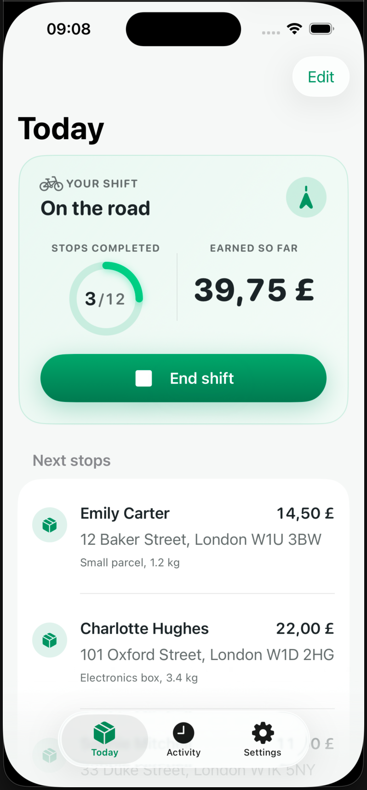
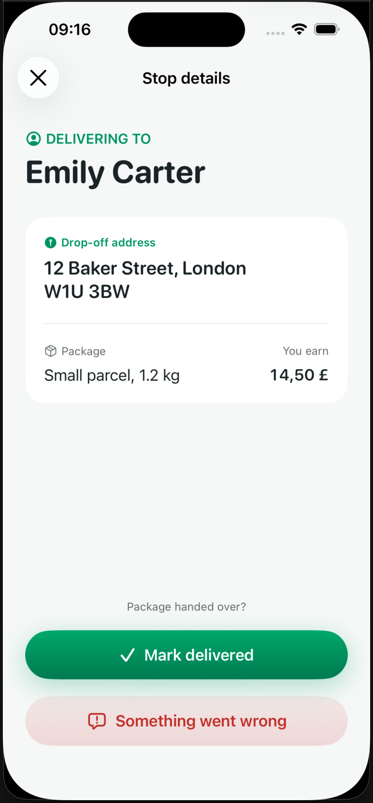
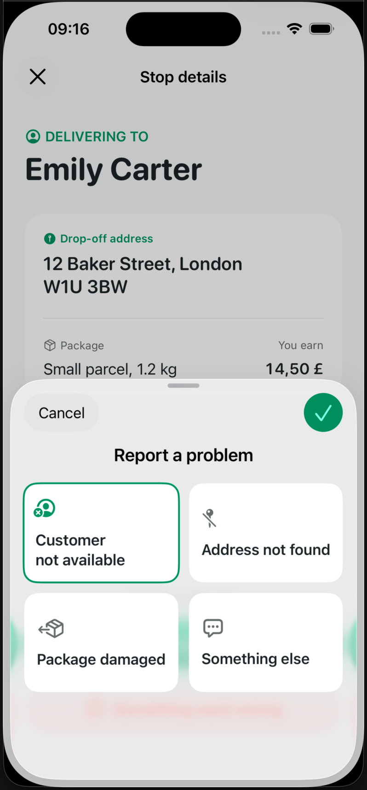
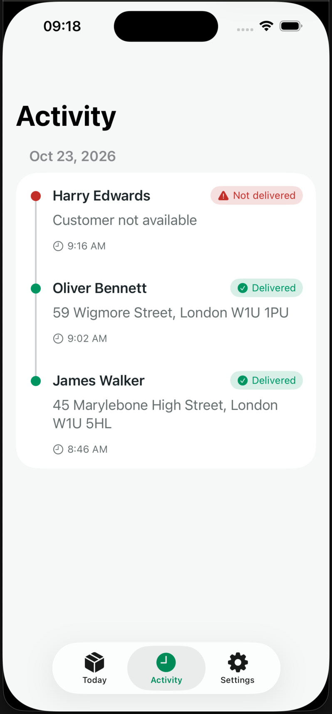
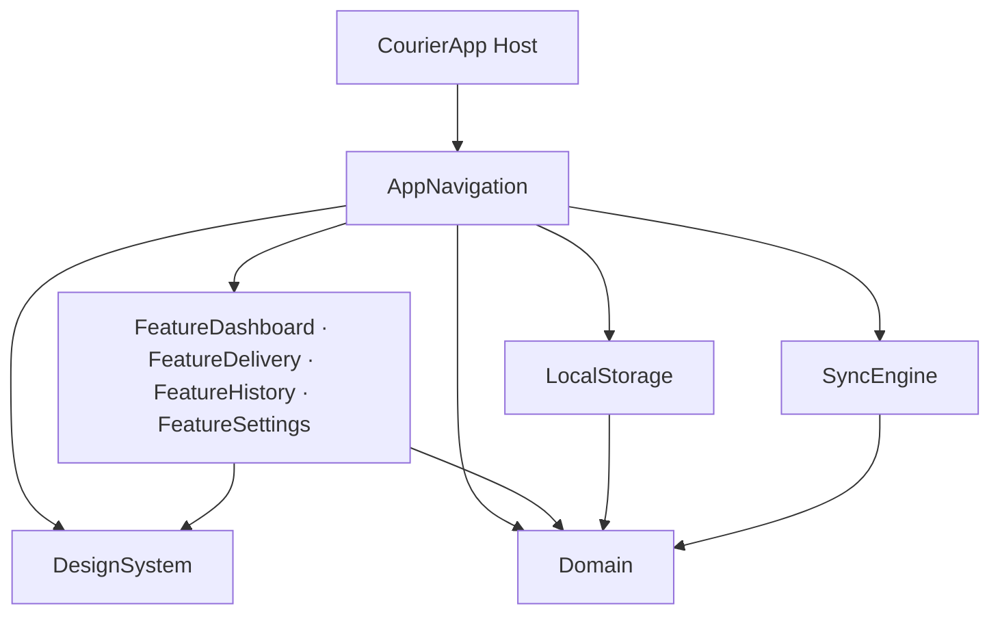

# CourierApp

<p align="left">
    
</p>

[](https://swift.org)
[](https://developer.apple.com/ios/)
[](https://developer.apple.com/xcode/)
[](LICENSE)

**A scalable blueprint for offline-first iOS application, designed for complex multi-module systems and large engineering teams.**

The CourierApp project demonstrates a modern architectural approach to building iOS apps. It utilizes independent Swift Package Manager (SPM) micro-modules, a strict domain-driven design, and an atomic outbox-based synchronization engine. 

Couriers can complete deliveries seamlessly while completely offline. Each task mutation and its corresponding remote sync job are persisted in a single local transaction, surviving app termination and syncing gracefully when connectivity returns. 

No third-party dependencies are used.

## Screenshots & Recordings

| Dashboard & Queue | Delivery Details |
| :---: | :---: |
|  |  |

| Exception Reporting | Activity History |
| :---: | :---: |
|  |  |


**Recording: Happy path**

https://github.com/user-attachments/assets/667d0437-e814-4c72-9d0d-4159c2d7254e

(See more recordings in [./Docs/Recordings/](./Docs/Recordings/))

## Key Capabilities

- **Offline-First with an Atomic Outbox:** Every state mutation is written to SwiftData and enqueues a `SyncJob` in the exact same database transaction. The UI is completely optimistic and only reads local, validated state.
- **Resilient Sync Engine:** A dedicated `SyncActor` wakes up at scheduled deadlines, drains the outbox queue FIFO, sends each job at most once per cycle, and guarantees at-least-once delivery using the job ID as an `Idempotency-Key`.
- **Decoupled "Undo" Window:** Tapping "Mark Delivered" holds its sync job for 5 seconds. This countdown is anchored to the persistent `completedAt` timestamp, meaning the Undo window survives view dismissal and even app relaunches.
- **Optimistic Queue Reordering:** Drag-and-drop updates the stop sequence instantly. Consecutive moves are debounced locally, coalescing into a single network request with a sliding deadline.
- **Built-in Network Simulation:** The Settings module includes QA tools to force offline mode, simulate network latency ranges, and inject specific HTTP failures (e.g., 401 Unauthorized, 500 Server Error), allowing both automated and manual testing of recovery paths.

## Modern Swift Concurrency

The project is compiled under **Swift 6 language mode** with `Strict Concurrency = Complete` and warnings treated as errors. In order to avoid data races and thread-blocking issues, actor isolation is applied strictly by architectural layer:

- **UI & Features (`@MainActor`):** `DesignSystem`, `Feature*` modules, and `AppNavigation` are isolated to the main thread by default.
- **Domain (`nonisolated`):** Entities, state machines, and repository protocols are pure `Sendable` structs.
- **Data & Network (`actor`):** `LocalStore` acts as a single-writer actor managing the SwiftData `ModelContext` off the main thread. `SyncActor` independently manages the outbox queue scheduling and network requests.

Features never query the database directly. They consume `AsyncStream`s of immutable domain snapshots, exposed by repository protocols.

## Architecture & Modularity

Arrows in the diagram represent compile-time dependencies. The package manifest creates a hard boundary preventing features from accidentally coupling to each other or the persistence layer.



- **Domain:** Defines the core contracts. It has absolutely zero dependencies on other modules.
- **Features:** SPM targets focused purely on UI and presentation logic. **Features never import each other.** Navigation between them is handled via callbacks routed through `AppNavigation`.
- **AppNavigation (Composition Root):** The only module aware of both `LocalStorage` and `SyncEngine`. It injects real dependencies into feature views and handles app-wide routing.

## Key Design Decisions (ADRs)

For deep dives into specific engineering problems and their solutions, refer to the Architecture Decision Records in the `Docs/adr/` directory.

| Problem | Decision | Evidence |
| --- | --- | --- |
| Features coupled to persistence or each other | Features depend on `Domain` contracts and `DesignSystem`; `AppNavigation` composes implementations and owns cross-feature navigation. | [Package manifest](CourierModules/Package.swift), [ADR-0003](Docs/adr/0003-composition-root-in-app-navigation.md) |
| SwiftData leaking into presentation | Repository `AsyncStream`s expose domain snapshots; `@Model` types stay strictly inside `LocalStorage`. | [ADR-0001](Docs/adr/0001-features-observe-streams-not-query.md), [Observation Tests](CourierModules/Tests/Core/LocalStorageTests/ObservationTests.swift) |
| Local changes losing sync state on crash | A single-writer `LocalStore` validates business invariants and writes each mutation alongside its `SyncJob` atomically. | [ADR-0006](Docs/adr/0006-single-writer-store-enforces-invariants.md), [Transition Tests](CourierModules/Tests/Core/LocalStorageTests/TaskTransitionTests.swift) |
| Server receives request, local ACK is lost | At-least-once delivery; the engine safely replays the persisted job with the same `Idempotency-Key`. | [ADR-0004](Docs/adr/0004-outbox-at-least-once-with-idempotency-key.md), [Resilience Tests](CourierModules/Tests/Core/SyncEngineTests/SyncResilienceTests.swift) |
| Undo logic tied to a screen's lifetime | A persisted `notBefore` holds the job for 5s; the background sync scheduler releases it independently of the UI. | [ADR-0005](Docs/adr/0005-undo-window-as-held-outbox-job.md), [Persistence Tests](CourierModules/Tests/Core/LocalStorageTests/DiskPersistenceTests.swift) |
| One failing delivery blocks unrelated work | A failing job blocks subsequent jobs for *the same task ID* (Head-of-Line blocking), but allows other tasks to proceed. | [Scheduling Tests](CourierModules/Tests/Core/SyncEngineTests/SyncSchedulingTests.swift) |

## Scope Boundaries & Trade-offs

To keep this project focused on architectural patterns, certain boundaries were established:
- **Mock API:** The "backend" is a bundled JSON snapshot. The `MockCourierAPI` intercepts requests, honors configured latency, and resolves conflicts. Real backend integration is outside the scope of this project.
- **Foreground Sync Only:** The sync queue drains while the app is active (or upon foregrounding). Background fetch processing (`BGTaskScheduler`) is intentionally omitted.
- **Last-Write-Wins:** HTTP 409 (Conflict) resolution compares the server's `serverUpdatedAt` with the local job's `createdAt`. A newer server version discards the local write.

## Tooling & Setup

### Requirements
- Xcode 26.6+
- iOS 26.0+ deployment target

### Getting Started
1. Clone the repository and open `CourierApp.xcodeproj`.
2. Run the `CourierApp` scheme on an iOS Simulator (signing is not required). 

For a physical device, copy `Config/Local.xcconfig.example` to `Config/Local.xcconfig` and set your Apple Developer Team ID. (file is git ignored to avoid publishing private team IDs)

### CLI Commands

The project uses a `Makefile` to streamline local verification and CI pipelines:

```bash
make check         # Quality gate: swift-format lint, Debug/Release builds, package tests
make test          # Runs all package unit tests followed by Host UI tests
make test-package  # Runs SPM unit tests only
make test-module MODULE=SyncEngineTests  # Runs tests for a specific module
make test-app      # Runs black-box XCTest UI tests
make format        # Applies swift-format to the codebase
make destinations  # Lists available simulator destinations
```

*Note: UI tests (`CourierAppUITests`) run as black-box tests utilizing accessibility identifiers. Setting the environment variable `COURIER_UI_TEST_SESSION` automatically provisions isolated on-disk databases for cross-launch offline testing.*

## License

This project is licensed under the MIT License — see the [LICENSE](LICENSE) file for details.
