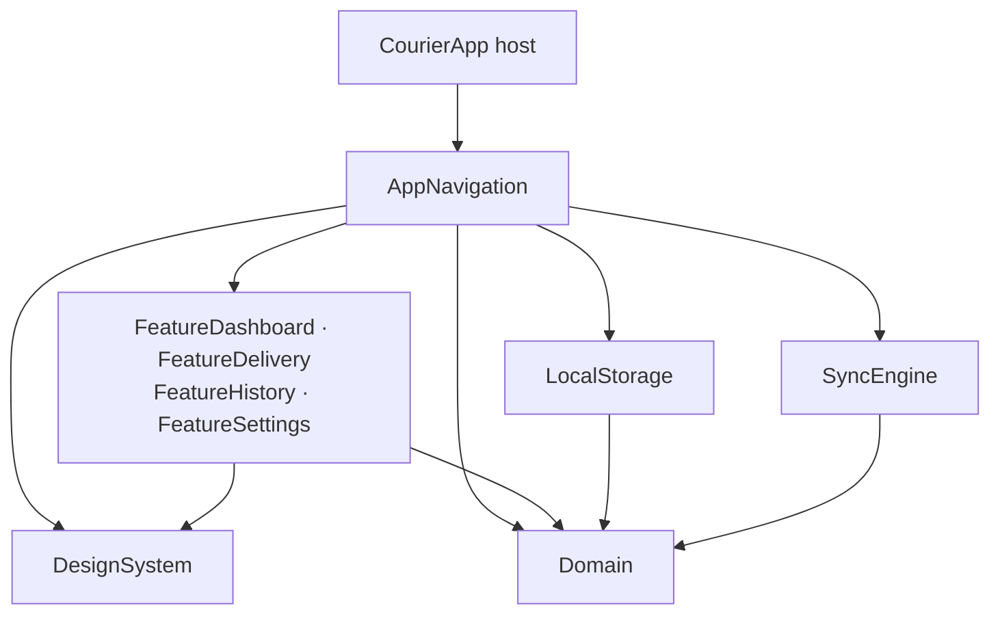

# CourierApp

**Clean iOS architecture with SPM micro-modules and an offline-first delivery workflow.**

[](https://github.com/kamilgomolka/demo-courier-app/actions/workflows/ci.yml)

Small, independently compiled Swift modules, separating domain logic, feature presentation, persistence, and sync. A local Swift package manifest makes dependency boundaries explicit; The app host links a single composition-root product.

Couriers can complete deliveries offline. Each task mutation and its outbox job are persisted in one transaction, survive app termination, and sync when connectivity returns. The workflow exercises module boundaries, concurrency, and failure recovery with SwiftUI, SwiftData, and Swift 6. No third-party dependencies.

[Design decisions](#key-design-decisions) · [Module boundaries](#module-boundaries) · [Failure recovery](#failure-recovery) · [Trade-offs](#scope--trade-offs)

## Key Design Decisions

| Problem | Decision | Evidence |
| --- | --- | --- |
| Features coupled to persistence or each other | Features depend on `Domain` contracts and `DesignSystem`; `AppNavigation` composes implementations and owns cross-feature navigation. | [Package manifest](CourierModules/Package.swift), [composition root ADR](Docs/adr/0003-composition-root-in-app-navigation.md) |
| SwiftData leaking into presentation | Repository `AsyncStream`s expose domain snapshots; `@Model` types stay inside `LocalStorage`. | [Observation ADR](Docs/adr/0001-features-observe-streams-not-query.md), [observation tests](CourierModules/Tests/Core/LocalStorageTests/ObservationTests.swift) |
| Local changes without a corresponding remote write | A single-writer `LocalStore` validates business invariants and writes each task mutation with its `SyncJob` atomically. | [Single-writer ADR](Docs/adr/0006-single-writer-store-enforces-invariants.md), [transition tests](CourierModules/Tests/Core/LocalStorageTests/TaskTransitionTests.swift) |
| Remote success followed by a lost local acknowledgement | At-least-once delivery replays the persisted job with the same `Idempotency-Key`. | [Outbox ADR](Docs/adr/0004-outbox-at-least-once-with-idempotency-key.md), [replay tests](CourierModules/Tests/Core/SyncEngineTests/SyncResilienceTests.swift) |
| Undo tied to a screen's lifetime | A persisted `notBefore` holds the job for the Undo window; the sync scheduler releases it independently of UI. | [Undo ADR](Docs/adr/0005-undo-window-as-held-outbox-job.md), [restart tests](CourierModules/Tests/Core/LocalStorageTests/DiskPersistenceTests.swift) |
| One failed delivery blocking unrelated work | A failed job blocks later jobs for the same `taskID` within a drain; other tasks proceed. Retries require an external trigger. | [Scheduling tests](CourierModules/Tests/Core/SyncEngineTests/SyncSchedulingTests.swift) |

## Module Boundaries

Arrows show compile-time dependencies. The four feature targets are grouped for readability.



- **Domain defines the contracts.** Models, `TaskStateMachine`, and repository protocols have no dependencies on other project modules. `LocalStorage` and `SyncEngine` depend only on `Domain`; they do not import each other.
- **Features own presentation.** Each has its own SPM target, resources, and test target. Features never import one another. `AppNavigation` injects dependencies, owns navigation, and is the only module that imports both storage and sync.
- **Isolation follows responsibility.** UI modules default to `MainActor`; domain, storage, and sync modules are `nonisolated`. `LocalStore` and `SyncActor` own their mutable state. [Isolation ADR](Docs/adr/0002-default-isolation-per-layer.md).

`DesignSystem` supplies shared tokens and views. `DomainTestSupport` supplies protocol fakes and a manual clock for tests and Debug-only previews; feature targets also depend on it for those previews.

## Failure Recovery

Tests exercise failure boundaries at three levels:

- **Storage:** reopen a disk-backed store and verify that task state and pending jobs survive, including the held Undo window. [DiskPersistenceTests](CourierModules/Tests/Core/LocalStorageTests/DiskPersistenceTests.swift).
- **Sync:** replay an unacknowledged write with the same key, drain overdue jobs after restart, and reset during an in-flight request. Scheduling tests drive `ManualTimeSource` to verify deadlines, cancellation, and retry behavior. [SyncResilienceTests](CourierModules/Tests/Core/SyncEngineTests/SyncResilienceTests.swift), [SyncSchedulingTests](CourierModules/Tests/Core/SyncEngineTests/SyncSchedulingTests.swift).
- **UI:** complete a delivery offline, terminate and relaunch the app with the same disk store, then reconnect and verify the outbox drains. [CourierAppUITests](CourierAppUITests/CourierAppUITests.swift).

## Scope & Trade-offs

- **Mock API:** bundled snapshots and configurable latency/failures make scenarios reproducible. Real backend integration is outside scope.
- **Foreground sync:** jobs drain while the app runs. Suspension defers delivery until the next foreground; background execution is outside scope.
- **Last write wins:** HTTP 409 resolution compares timestamps. A newer server version can discard a local write.
- **Insert-only bootstrap:** initial load seeds an empty database; it does not reconcile later server changes to existing records.
- **Persisted Undo window:** the job remains held across relaunch, but the Undo toast is not restored.

## Tooling

Xcode 26.6 · iOS 26+ · Swift 6 language mode · strict concurrency and memory safety · warnings as errors.

Open `CourierApp.xcodeproj` and run the `CourierApp` scheme on an iOS Simulator. The default test destination is iPhone 17 Pro, iOS 26.5; override with `SIMULATOR` and `OS`.

```bash
make check  # formatting lint, Debug/Release builds, package tests
make test   # package tests and host UI tests
make test-module MODULE=SyncEngineTests
```

[CI](.github/workflows/ci.yml) runs lint, package and UI tests, and a Release build. See the [Makefile](Makefile) for individual commands, [CONTEXT.md](CONTEXT.md) for domain vocabulary, and [ADRs](Docs/adr/) for decision details.

MIT — see [LICENSE](LICENSE).
