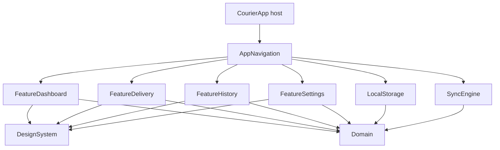

# CourierApp

[](https://github.com/kamilgomolka/demo-courier-app/actions/workflows/ci.yml)
[](https://swift.org)
[](https://developer.apple.com/ios/)
[](https://developer.apple.com/xcode/)
[](LICENSE)

An architecture playground for a courier's daily workflow (iPhone only): offline-first, optimistic UI, outbox-based sync, micro-modules in a local Swift package, Swift 6 strict concurrency. Features are kept to the minimum needed to exercise those mechanisms; vocabulary is in [`CONTEXT.md`](CONTEXT.md) and architectural decisions are in [`Docs/adr`](Docs/adr).

## Demo

| Today | Delivery details | Sync simulation & outbox |
| --- | --- | --- |
| _Screenshot placeholder_ | _Screenshot placeholder_ | _Screenshot placeholder_ |

_Recording placeholder: go offline → complete a delivery → inspect the pending outbox → relaunch → go online → watch the outbox drain._

## What It Shows

- **Offline-first with an outbox.** Every task mutation is written to SwiftData and enqueues a `SyncJob` in the same transaction. Shift mutations stay local. The UI only ever reads local state.
- **Single outbox consumer.** `SyncActor` wakes at the earliest `notBefore`, drains FIFO, sends each job at most once per cycle and uses the job id as `Idempotency-Key` (at-least-once delivery, idempotent server).
- **Delayed commit with Undo.** "Mark Delivered" holds its sync job for 5 s (`SyncPolicy.undoWindow`), closes the details screen and shows an app-wide Undo toast. Undo removes the job; expiry releases it even if the toast is no longer visible.
- **Debounced reorder.** Drag-and-drop updates the queue optimistically; consecutive moves coalesce into one job whose deadline slides forward.
- **Observation without `@Query`.** Features consume `AsyncStream`s from repository protocols and never see `@Model`.
- **Network simulation.** Settings can force offline, latency range and failure type, show the outbox with attempts and last failure, reset local data, and trigger a manual sync.
- **Injected time.** `TimeSource` lets tests drive scheduling with a manual clock.

## Architecture



```
CourierApp/                  # Host: App.swift only, links the AppNavigation product
CourierAppUITests/           # Black-box UI tests (XCTest) driven by accessibility identifiers
CourierModules/              # Local Swift package
├── Sources/
│   ├── Core/
│   │   ├── Domain/          # Models, state machine, repository protocols (nonisolated)
│   │   ├── DomainTestSupport/ # Fakes, fixtures, manual clock (tests and Debug-only previews)
│   │   ├── LocalStorage/    # SwiftData schema and the LocalStore actor
│   │   ├── SyncEngine/      # SyncActor and the mock API (static JSON, latency, simulated failures)
│   │   └── DesignSystem/    # Color tokens, typography, reusable views
│   ├── Features/
│   │   └── Feature{Dashboard,Delivery,History,Settings}/
│   └── App/
│       └── AppNavigation/   # Composition root, tabs, router
└── Tests/                   # Swift Testing, one test target per module, mirrors Sources/{Core,Features}
Config/                      # xcconfig: language mode, strictness, warnings-as-errors
```

Features do not know each other. Dashboard reports `onSelectTask(id)`, `AppNavigation` owns the paths and builds the destination from `FeatureDelivery`.

## Trade-offs & Production Notes

- **Mock backend.** `MockCourierAPI` reads a bundled JSON snapshot and accepts duplicate `Idempotency-Key`s. The initial load runs only on an empty database and after a reset; there is no pull-to-refresh and merging is insert-only.
- **No background delivery.** Jobs are drained while the app runs, on launch, foreground, screen appearance and connectivity changes. A suspended process does not send anything; the next foreground drains overdue jobs.
- **Undo is an app-wide toast.** The 5 s window is anchored to the stored `completedAt`, so a relaunch inside the window keeps the job held; the toast itself does not survive a relaunch.
- **Contracts in `Domain` are the integration surface.** Fakes in `DomainTestSupport` implement the same protocols, which keeps UI tests of models free of SwiftData.
- **Default isolation differs per layer.** `MainActor` for UI modules, `nonisolated` for `Domain`, `LocalStorage` and `SyncEngine`, so storage and sync stay off the main thread.
- **No third-party dependencies.** iOS 26 only.
- **Not covered by automation:** visual polish and drag-and-drop feel, background suspension behaviour, and the CI runner's Xcode path until the first CI run.

## Requirements

- Xcode 26.6 (CI pins `/Applications/Xcode_26.6.app`)
- iOS 26.0+ deployment target; tests run on iPhone 17 Pro, iOS 26.5
- Swift 6 language mode, strict concurrency, strict memory safety

## Getting Started

```bash
git clone https://github.com/kamilgomolka/demo-courier-app.git
cd demo-courier-app
open CourierApp.xcodeproj
```

Run the `CourierApp` scheme on an iOS 26+ Simulator. Signing is not required for the Simulator. For a device, copy `Config/Local.xcconfig.example` to `Config/Local.xcconfig` and set your Team ID (the file is untracked).

Launching a Debug build with `--ui-testing` uses an in-memory store and short mock latency. Setting `COURIER_UI_TEST_SESSION` to a UUID additionally selects an isolated disk store in the app's caches directory and a matching settings suite; reusing the UUID preserves both across relaunches. The offline/relaunch UI test uses this mode.

## Tooling

```bash
make check         # lint, Debug/Release builds and package tests; the local quality gate
make build         # build the app for the Simulator (warnings are errors)
make build-release # build Release with the same strict warning policy
make test          # package tests, then UI tests
make test-package  # CourierModules unit tests only
make test-module MODULE=SyncEngineTests  # one package test target
make test-app      # host UI tests only
make format        # apply swift-format in place
make lint          # swift-format --strict, no changes
make destinations  # list available Simulator destinations
```

Override the Simulator with `make build SIMULATOR='iPhone 17 Pro' OS=26.5`. If `xcode-select` points at another Xcode, prefix commands with `DEVELOPER_DIR=/Applications/Xcode_26.6.app/Contents/Developer`, adjusting the path to your installed Xcode.

Manual log inspection: `xcrun simctl spawn booted log stream --predicate 'subsystem == "com.kamilgomolka.CourierApp"'`.

## Built with an Agentic Workflow

This repository doubles as an experiment in AI-assisted development. The specification, architectural decisions, code review, and verification are mine; [Cursor](https://cursor.com/) executes against them. The loop is grill, PRD, vertical-slice issues, TDD, `make check`, review. Agent context lives in [`AGENTS.md`](AGENTS.md), [`CONTEXT.md`](CONTEXT.md), `.cursor/rules` and `.cursor/skills`. Nothing lands without passing the review step and a green CI run.

## License

MIT — see [LICENSE](LICENSE).
